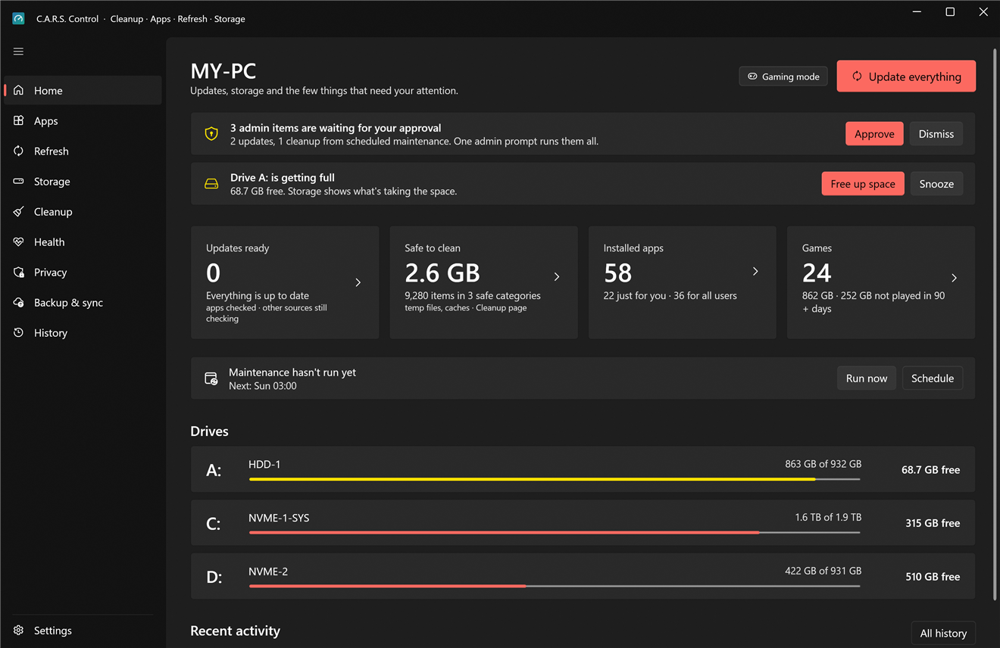

# C.A.R.S. Control

**Cleanup · Apps · Refresh · Storage** — and now **Health** and **Backup**. One Windows app to see, update, uninstall, clean up and keep an eye on everything on your PC, built to replace a pile of separate tools: package-manager front ends, uninstallers, disk analyzers, cleaners, startup and driver managers, hardware monitors and backup scripts.

<p align="center"></p>

> Windows 10 (2004 or newer) and Windows 11, 64-bit. Free and open source (MIT). Not code-signed yet (see [Install](#install)). A macOS version is planned.

## Install

1. Download **`CarsControl-Setup-<version>.exe`** (and `SHA256SUMS.txt`) from the **[Releases page](https://github.com/CarCar08/cars-control/releases)**.
2. Double-click it **as yourself** (not "Run as administrator"). Windows SmartScreen will say **"Windows protected your PC"** because the installer isn't signed yet: click **More info › Run anyway**. You can first check the download: `(Get-FileHash .\CarsControl-Setup-<version>.exe).Hash` must match the line in `SHA256SUMS.txt`.
3. Click **Install**, approve the single Windows administrator prompt, and let it finish. If the .NET 10 Desktop Runtime is missing, Setup downloads it from Microsoft for you.
4. Open **C.A.R.S. Control** from the Start menu, as yourself. A short first-time setup offers sensible defaults; every answer can be changed later, and **Skip all** loses nothing.

That's it. Updates after that are one button (**Settings › About & updates**). The **[full install and setup guide](docs/install.md)** covers every screen, a good first hour, phone alerts, updating, repair, uninstalling, silent installs, where everything lives and troubleshooting. Prefer to build it yourself? See [docs/building.md](docs/building.md).

## What it does

| Page | |
|---|---|
| **Home** | A **Needs attention** list first (approvals waiting, restart pending, drive or crash problems, failed backups, a new version), then **Update everything**, updates ready, space that's safe to clean, apps, games, drives and recent activity. Gaming, admin and VPN chips. |
| **Apps** | **Installed**: every app (registry, Store/MSIX and winget) with real sizes, bulk **uninstall** with a leftover review. **Get apps**: search winget and the Store, install for you or for everyone, save and restore **app lists**. **Startup**: apps, services and scheduled tasks with exact undo. **Right-click menu**: see and hide what apps added. |
| **Refresh** | Updates from winget, Windows Update, WSL, PowerShell modules, npm and pip, and the **Windows Update** tab: pause, keep drivers out, delay feature updates, active hours, hide updates. |
| **Storage** | **Explore** each drive as a treemap (Fast scan through [WizTree](https://diskanalyzer.com/) in seconds), **big & old files**, **duplicates**, **junk**, **games** (and moving Steam and Epic games to another drive), **move folders** (with a link), and **guided removal of an old Windows install**. |
| **Cleanup** | Temp files, caches, shader caches, broken shortcuts, the Recycle Bin and admin-only items, each measured before anything is deleted. |
| **Health** | Specs and a shareable report, **sensors** (GPU, and CPU/board with the optional PawnIO driver), **drive health**, **blue-screen analysis** with WinDbg, exact **freeze** detection, sleep and boot times, **drivers** (and old copies Windows keeps), **what's using the PC**, and **network and VPN** status (Proton VPN and Tailscale cards appear when those are installed). Every value has a tooltip, and (?) buttons explain each section. |
| **Privacy** | 38 switches for telemetry, ads, AI extras, Edge, Office and taskbar clutter, each showing what's set right now and undoable exactly. Remove the Store apps that came with Windows; see who used your camera, microphone and location. |
| **Backup & sync** | **Backups** to a folder (a cloud drive such as Proton Drive or OneDrive gives you an off-site copy), a USB drive recognised by its volume ID, or another disk; **your setup** synced between PCs; a **Your PCs** status board. |
| **History** | Every operation with its full output, filters, CSV export, **Restore** for quarantined leftovers and **Find leftovers…** for apps removed earlier. |
| **Settings** | Appearance, scheduled maintenance, Gaming mode, phone alerts, Health, the command palette, background work, the admin helper, holds for this PC, protected apps, ignored updates, updates. |

**Keyboard:** **Ctrl+K** opens the command palette; **Ctrl+Alt+Space** (changeable) opens it from any program. **Ctrl+1 … Ctrl+9** and **Ctrl+0** switch pages.

**More screenshots and how each page works:** [user guide](docs/user-guide/README.md).

## Everyday automation

- **Scheduled maintenance** (default Sunday 03:00): the updates and cleanup categories you pick run as you while you're away; a missed run catches up once, never during a game. Admin parts wait in an **approval queue** until you're back, then run with one prompt.
- **Gaming mode** turns on by itself when a game starts: C.A.R.S. pauses its own work, and (with an admin session approved once at sign-in) Windows Update, search indexing and standby memory, then resumes everything. Your power plan, notifications and other apps are left alone.
- **Phone alerts** through [ntfy](https://ntfy.sh): failures, blue screens, drive health, temperatures, low space, failed backups. Counts, drive letters and times only, never names or paths; quiet hours.
- **Restart when I'm away** finishes a pending update restart at a quiet time, with a five-minute countdown you can cancel.
- **Backups** run on a schedule while you're away, or when your USB drive is plugged in.
- **A restore point** is made before risky changes (driver cleanup, driver and feature updates, privacy batches).

All of it: [docs/user-guide/automation.md](docs/user-guide/automation.md).

## How admin rights work

The app **always runs as you**. Per-user work (your apps, your files, your registry, your privacy switches) is done as you, with no prompt; running it elevated is the classic failure of other updaters on a standard account. Machine-wide work (Windows Update, apps for all users, system cleanup, drivers, services) goes to a small separate helper, `CarsControl.Helper.exe`, started through the normal Windows prompt, once per session.

- The helper accepts **35 typed operations carrying identifiers only** (a winget id, a cleanup-rule id, a privacy-switch id, an update GUID, a drive letter, an Epic manifest id), validates each again on its own side, and works out what to run itself. There is no "run this command" and no "delete this path".
- It only talks to the `CarsControl.exe` that launched it, from its own administrators-only folder, and exits when idle or when the app closes.
- **Unattended work never shows a prompt**: scheduled maintenance and Gaming mode use an admin session only if one is open, and otherwise wait for you.
- Nothing persistent: no service, no scheduled task, no startup entry (except the per-user one you switch on).

Every operation, what it validates, everything the app connects to and what it stores: **[docs/security.md](docs/security.md)**. Report a vulnerability privately: [SECURITY.md](SECURITY.md).

## Safe by default

- Launchers (Steam, Epic, EA, Ubisoft, Rockstar, Riot) update themselves; re-running their installers with winget can break them, so they're excluded.
- Unticked by default: pip upgrades, GPU shader caches, emptying the Recycle Bin, broken shortcuts, crash evidence, and anything your **This PC** holds cover.
- "Success" is **verified**: an uninstall must make the entry disappear, an update must change the version, a move must match file for file before the original goes, a backup never deletes what's already there.
- Leftovers are **quarantined** (restorable for 30 days), cleanup and duplicates use the Recycle Bin, privacy switches remember the original value, and backups keep older versions for 30 days.
- The Privacy page never touches Defender, SmartScreen, the firewall, UAC, Windows Update or Windows Error Reporting.
- Nothing is sent anywhere except what's listed in [the connections table](docs/security.md#7-what-it-connects-to). No telemetry.

## Your data

| | |
|---|---|
| `%LOCALAPPDATA%\CarsControl\settings.json` | Your choices, plain JSON (safe to back up or edit). An ntfy access token is stored encrypted for your Windows account. |
| `%LOCALAPPDATA%\CarsControl\cars.db` | History, saved scans, update results, maintenance state, the approval queue, crash analyses and undo snapshots (SQLite). |
| `%LOCALAPPDATA%\CarsControl\Quarantine` | Your quarantined leftovers. |
| `%LOCALAPPDATA%\CarsControl\logs` | `perf.log` (timings) and `errors.log` (anything unexpected; rotates at 1 MB). |
| `C:\ProgramData\CarsControl` | The helper's logs, scans, machine-wide quarantine and undo snapshots (administrators write, users read). |

## Documentation

| | |
|---|---|
| **[Install & setup guide](docs/install.md)** | Download, install, first-time setup, a good first hour, ntfy on your phone, updating, uninstalling, troubleshooting, FAQ. |
| **[User guide](docs/user-guide/README.md)** | One page per area of the app. |
| **[Security](docs/security.md)** | The design, every helper operation, every connection, honest limits. |
| **[Building](docs/building.md)** | Build from source, layout, tests, the release pipeline. |
| **[Testing](docs/testing.md)** | The test suite and the screen-capture and keyboard audit tools. |
| **[Reporting a problem](docs/install.md#11-faq)** | In the app: **Settings › About & updates › Report a problem** (or **Report it** on an error message) opens a pre-filled bug report you review before sending. Security problems: [privately](SECURITY.md). |
| **[Contributing](CONTRIBUTING.md)** · [Changelog](CHANGELOG.md) · [Third-party notices](THIRD-PARTY-NOTICES.md) | |

## Development

```
dotnet build CarsControl.sln
dotnet test tests\CarsControl.Tests
```

**Layout:** `src\CarsControl.Contracts` (helper protocol), `src\CarsControl.Core` (everything that isn't UI), `src\CarsControl.App` (WPF + [WPF-UI](https://github.com/lepoco/wpfui)), `src\CarsControl.Helper`, `src\CarsControl.Setup` + `Setup.Core` (the installer), `tools\CarsControl.Probe` (a read-only CLI that runs Core against the real PC), `tools\ui-audit` (screen capture, click and keyboard audits), `tests`. Needs the .NET 10 SDK (it also builds on .NET 8). More in [docs/building.md](docs/building.md).

**winget COM from an unpackaged app:** `Microsoft.Management.Deployment.winmd` (from [winget-cli](https://github.com/microsoft/winget-cli), MIT) must sit next to the exe, and its vectors must be read by index, not enumerated.

## Third-party components

WPF-UI, CommunityToolkit.Mvvm, Microsoft.Data.Sqlite, QRCoder and others (MIT), **LibreHardwareMonitorLib** (MPL-2.0, shipped unmodified) and the optional **PawnIO** driver (downloaded on request from its own release). The complete list with versions, licences and sources is in [THIRD-PARTY-NOTICES.md](THIRD-PARTY-NOTICES.md), which also ships with the app (Settings › About & updates › Licenses).

## License

[MIT](LICENSE)
