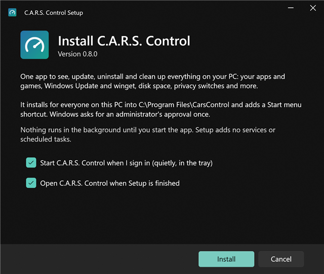
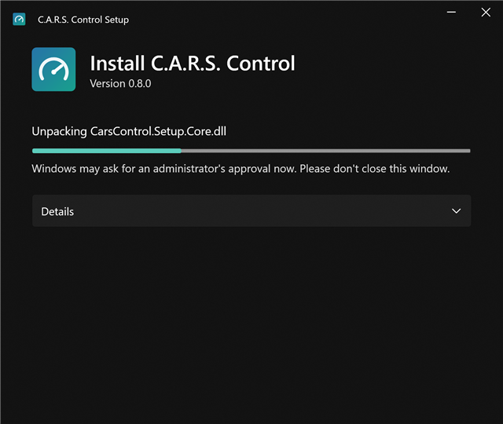
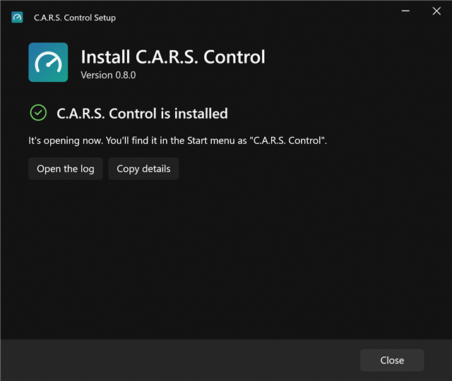
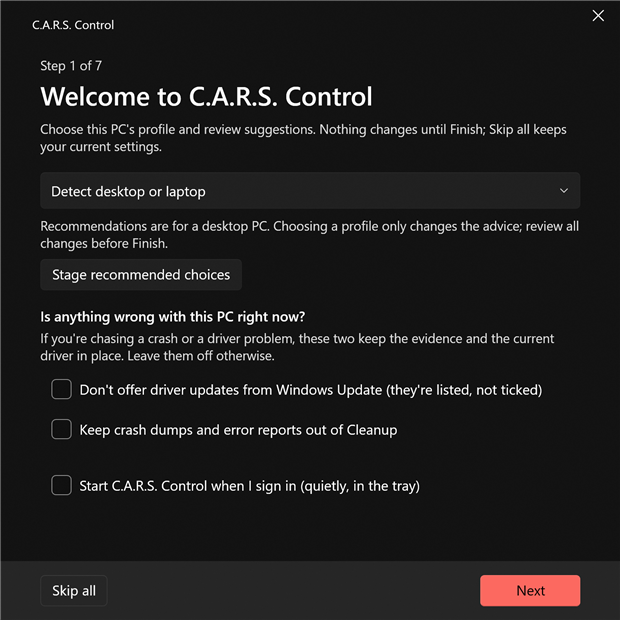

# Installing C.A.R.S. Control

This is the complete guide to downloading, installing, setting up, updating and removing C.A.R.S. Control on Windows. If you only want the short version, see [the quick start in the README](../README.md#install).

**Contents**

1. [What you need](#1-what-you-need)
2. [Download it](#2-download-it)
3. [Run Setup](#3-run-setup)
4. [First start and the first-time setup](#4-first-start-and-the-first-time-setup)
5. [A good first hour](#5-a-good-first-hour)
6. [Updating](#6-updating)
7. [Repair and uninstall](#7-repair-and-uninstall)
8. [Installing without the window (scripts, several PCs)](#8-installing-without-the-window)
9. [Where everything lives](#9-where-everything-lives)
10. [Troubleshooting](#10-troubleshooting)
11. [FAQ](#11-faq)

---

## 1. What you need

| | |
|---|---|
| **Windows** | Windows 11, or Windows 10 version 2004 (May 2020) or newer. 64-bit (x64). On an ARM PC it runs through Windows' x64 emulation, which is untested. |
| **Space** | About 60 MB for the program. If your PC doesn't have Microsoft's **.NET 10 Desktop Runtime** yet, Setup downloads and installs it for you (about 60 MB download). |
| **Administrator approval** | Setup asks for it **once**. On an administrator account that's a "Yes" button; on a standard account Windows asks for an administrator's password or PIN. See [why](#why-does-it-need-administrator-rights). |
| **Internet** | Only for downloading Setup, the .NET runtime if it's missing, and later updates. The app itself works offline (winget, Windows Update and the other sources it checks need a connection, of course). |

C.A.R.S. Control is a **per-PC install with per-user data**: one copy of the program for everyone on the PC, and each Windows user gets their own settings, history and scans.

## 2. Download it

1. Open the project's **[Releases page](https://github.com/CarCar08/cars-control/releases)**.
2. Under the newest release that isn't marked *Pre-release*, download **`CarsControl-Setup-<version>.exe`** (for example `CarsControl-Setup-1.0.0.exe`). That one file is everything: the app, its admin helper and the installer. There's nothing else to unzip.
3. Also download **`SHA256SUMS.txt`** if you want to check the file (recommended, takes ten seconds):

   ```powershell
   # in the folder you downloaded to
   (Get-FileHash .\CarsControl-Setup-1.0.0.exe -Algorithm SHA256).Hash
   Get-Content .\SHA256SUMS.txt
   ```

   The two hashes must be identical (capitalisation doesn't matter). If they aren't, delete the download and get it again.

### "Windows protected your PC" (SmartScreen)

Because Setup isn't code-signed yet (a signing certificate costs money every year; it's on the list), Windows shows a blue **"Windows protected your PC"** box the first time you run any new, little-downloaded program. This is expected. To continue:

1. Click **More info**.
2. Click **Run anyway**.

You only have to do this once per downloaded file. If you'd rather not run a program you can't verify, you have two good options: compare the checksum as shown above, or [build it yourself from source](building.md). Both produce the same program.

Some antivirus products are cautious about brand-new installers too. If yours blocks it, check the file's hash against `SHA256SUMS.txt` and the [Releases page](https://github.com/CarCar08/cars-control/releases), and report a false positive to the vendor.

## 3. Run Setup

Double-click `CarsControl-Setup-<version>.exe` **as yourself**: don't right-click and choose "Run as administrator". Setup asks for administrator rights by itself, only for the part that needs them. (If Setup is started as a *different* account than the one you're signed in with, it refuses and tells you why: your "start with Windows" setting and your data folder would land in the wrong profile.)

### The welcome screen



It tells you what will happen and where (`C:\Program Files\CarsControl`), and offers two choices:

* **Start C.A.R.S. Control when I sign in (quietly, in the tray).** Adds a normal per-user startup entry. It starts hidden in the notification area, checks for updates in the background and does nothing else. You can change this later in Settings › Background work.
* **Open C.A.R.S. Control when Setup is finished.**

If the .NET 10 Desktop Runtime is missing, the screen says so, and that Setup will download it from Microsoft.

Click **Install**.

### The administrator prompt

Windows now shows its standard prompt: the program is **CarsControl-Setup**, publisher *Unknown* (because it's unsigned). Approve it. Setup then runs its administrator half, which does exactly this, in order:

1. **Checks the .NET 10 Desktop Runtime.** If it's missing: downloads Microsoft's installer from Microsoft's own servers, checks it against the SHA-512 Microsoft publishes (and refuses to run it if it doesn't match), installs it silently. This is the longest step, about a minute.
2. **Unpacks the app** next to the final folder (`CarsControl.new`) and **checks every file against its hash**. A damaged download is stopped here, before anything on your PC is touched.
3. **Closes the old version**, if there is one (the app is asked to quit properly first).
4. **Swaps the folders in one step**: the old folder is renamed aside, the new one renamed into place. If anything fails after that point, the old version is put back.
5. **Locks the folder to administrators.** The admin helper lives there, so Setup verifies that standard users can't write to it and refuses to continue if they could.
6. **Adds the Start menu shortcut** and the entry in *Settings › Apps*.
7. **Checks `C:\ProgramData\CarsControl`**: if a standard user created that folder earlier, it's moved aside, because the admin helper writes there.



Setup adds **no services, no scheduled tasks and no startup entries** (other than the per-user one you chose). Nothing runs until you start the app.

### Finishing



If you left "Open C.A.R.S. Control" ticked, it opens now. Otherwise find **C.A.R.S. Control** in the Start menu. The log of what Setup did is `%TEMP%\CarsControl-Setup.log` (the **Open the log** button shows it).

### Why does it need administrator rights?

* **To install into `C:\Program Files`**, the only place a standard user can't tamper with the files.
* **Because the app has an admin helper** (`CarsControl.Helper.exe`). The app itself always runs as *you*; when a task needs more (Windows Update, machine-wide apps, system cleanup), it starts the helper, which takes a fixed list of typed operations and nothing else. The helper must sit in a folder only administrators can write to, or any program running as you could swap it and gain admin rights. [How the helper is locked down](security.md).

## 4. First start and the first-time setup

On a brand-new install the app opens **first-time setup** over the main window: seven short, scrollable steps. Choices are staged until the final review; **Skip all** keeps your current preferences and marks setup as seen.



1. **This PC.** Choose Desktop, Laptop, Gaming PC or automatic detection. **Stage recommended choices** fills the wizard with advice for that profile without applying it. Optional driver/crash-evidence holds and start-at-sign-in are also offered.
2. **What runs by itself.** Scheduled maintenance uses the schedule already in Settings; Gaming mode and sign-in approval are optional. Restart when away uses Health's restart window, idle requirement and cancellable countdown.
3. **Privacy.** Turns on the privacy switches that only change **your own account** (no admin needed): advertising ID, tailored experiences, tips and suggestions, and so on. The all-users ones (Copilot, Recall, Edge, Office…) are on the Privacy page.
4. **Backup and setup sync.** Explains the difference and can open either configuration page after Finish; no job or folder is created automatically.
5. **Sensors.** Choose whether to read CPU and board sensors when available; optionally open Health > Sensors after Finish. Installing PawnIO remains a separate explicit action.
6. **Phone alerts.** Optionally open Settings > Phone alerts after Finish. Setup does not subscribe or send a message.
7. **Review.** Lists the changes before saving. **Undo setup settings** in Settings > This PC restores the previous settings, hold reasons and sign-in choice. Privacy switches have their own individual undo on Privacy; backup jobs and installed drivers are configured separately.

Run it again any time: Settings › About &amp; updates › *Run the first-time setup again*.

## 5. A good first hour

None of this is required; it's the order that gets the most value fastest.

1. **Look at Home.** The *Needs attention* list at the top is the only thing that wants a decision; the cards below it are updates, space you can clean, installed apps and games, and your drives.
2. **Refresh → Check now.** See what's out of date across winget, Windows Update, WSL, PowerShell modules, npm and pip. Tick what you want and press **Update selected**. Anything that needs administrator rights shares **one** prompt.
3. **Storage → pick a drive → Scan.** Install [WizTree](https://diskanalyzer.com/) (free for personal use) once for 10-second scans of NTFS drives; otherwise a normal scan takes a minute or two per drive. *Big & old files* shows where the space went and who owns each file (apps, games and Windows files can't be recycled by mistake).
4. **Cleanup → Clean selected.** Everything is measured before anything is deleted, and the default ticks are the safe ones.
5. **Privacy → Turn all on**, then look through what changed (each switch can be undone exactly).
6. **Settings → Scheduled maintenance** if you want it to happen by itself.
7. **Press Ctrl+K** (or **Ctrl+Alt+Space** from any app) to open the command palette: type "up", "clean", a game's name, a setting.

### Phone alerts with ntfy (iPhone and Android)

C.A.R.S. can send a short notification to your phone when something needs you: a failed update, a nearly full drive, a blue screen. It uses [ntfy](https://ntfy.sh), a free open-source notification service. The messages contain counts, drive letters and times only, never file or app names.

1. Install the free **ntfy** app on your phone (App Store / Google Play).
2. In C.A.R.S.: **Settings › Phone alerts**, switch it on. A random topic name is made for you (it is the only "password" to your alerts, so don't share it) and shown as a QR code.
3. On the phone: scan the QR code with the camera, copy the text, open ntfy, tap **+**, paste it as the topic, **Subscribe**.
4. Back in C.A.R.S.: press **Send test**. It should arrive in a second or two.
5. Set quiet hours (default 23:00–08:00; drive-health problems and a nearly full drive still come through).

To use your own ntfy server, change *Server* (https only); if it needs a login, paste an access token (stored encrypted for your Windows account).

### Gaming mode and the sign-in prompt

If you leave *Ask for administrator rights once at sign-in* on, about 20 seconds after you sign in Windows asks for approval **once**. That keeps an admin session open for the day so that when a game starts, C.A.R.S. can pause Windows Update and search indexing and free standby memory without ever interrupting you. Decline it and Gaming mode still pauses C.A.R.S.'s own work; the admin parts are skipped and the session log says so. Salad, your notifications and your power plan are never touched.

## 6. Updating

* **Automatically noticed.** Once a day (never while you play) C.A.R.S. checks this project's Releases. If there's a newer version it downloads it, **verifies its checksum against the release's `SHA256SUMS.txt`**, and shows *"C.A.R.S. Control x.y.z is ready to install"* on Home and as a notification. Nothing is installed until you press **Update now**.
* **Update now.** Setup takes over: it asks the app to close, replaces the files (rolling back if anything fails) and opens the app again. One administrator prompt. Your settings, history, scans and ignore rules are untouched.
* **Manually.** Settings › About &amp; updates › **Check now**; or just download a newer `CarsControl-Setup` from Releases and run it: it detects the installed version and offers **Update**.
* **Pre-releases.** Off by default. Settings › About &amp; updates › *Also offer pre-releases* turns on release candidates.
* **Skip a version** with the *Skip this version* button; the next one is offered as usual.

## 7. Repair and uninstall

Run Setup again (or open it from *Settings › Apps › C.A.R.S. Control › Modify*):

| If the installed version is… | Setup offers |
|---|---|
| older than Setup | **Update** |
| the same as Setup | **Repair** (puts every file back exactly as shipped; your data isn't touched) |
| newer than Setup | to **install the older one anyway** (your data is kept, but a newer version may have changed it in ways an older one doesn't understand) |

**Uninstall** is on the same screen, and in *Settings › Apps › C.A.R.S. Control › Uninstall*. It removes the program, the Start menu shortcut, the *Apps* entry and the "start with Windows" entry. It then asks whether to also delete:

* **your settings, history and scans** (`%LOCALAPPDATA%\CarsControl`), and
* **the admin helper's logs and quarantined leftovers** (`C:\ProgramData\CarsControl`).

Neither is deleted unless you tick the box. Things you changed *inside* the app stay as you left them, because they're Windows settings, not C.A.R.S. files: privacy switches, hidden startup entries, removed Store apps. **Switch those back in the app first** if you want Windows' defaults. The Privacy page has a **Windows default** button on every row.

A leftover-free removal by hand, if Setup is gone: delete `C:\Program Files\CarsControl`, `C:\ProgramData\CarsControl`, `%LOCALAPPDATA%\CarsControl`, the Start menu shortcut `C:\ProgramData\Microsoft\Windows\Start Menu\Programs\C.A.R.S. Control.lnk`, the registry key `HKLM\SOFTWARE\Microsoft\Windows\CurrentVersion\Uninstall\CarsControl` and the value `CarsControl` under `HKCU\Software\Microsoft\Windows\CurrentVersion\Run`.

## 8. Installing without the window

Setup takes command-line options, for scripts, several PCs or a package manager:

| Command | What it does |
|---|---|
| `CarsControl-Setup.exe` | The wizard. |
| `CarsControl-Setup.exe --install --silent` | Installs with no window (one administrator prompt). Doesn't start with Windows, doesn't open the app. |
| `--update --silent` | Updates an existing install, keeping its "start with Windows" choice. |
| `--repair --silent` | Repairs it. |
| `--uninstall --silent --keep-data` | Uninstalls and keeps `%LOCALAPPDATA%\CarsControl` (and the helper's ProgramData). |
| `--uninstall --silent --remove-data` | Uninstalls and deletes both data folders. |
| `--launch` | Open the app when finished (default for `--update`). |

The exit code is `0` for success and `1` for failure; the log is `%TEMP%\CarsControl-Setup.log`. `--silent` still shows the Windows administrator prompt: Setup doesn't try to get around it, so a fully unattended install needs the PC's own software-deployment tooling to run it elevated.

## 9. Where everything lives

| What | Where |
|---|---|
| The program | `C:\Program Files\CarsControl` (writable by administrators only) |
| Your settings (plain JSON, safe to back up and edit) | `%LOCALAPPDATA%\CarsControl\settings.json` |
| History, scans, update results, undo snapshots | `%LOCALAPPDATA%\CarsControl\cars.db` (SQLite) |
| Logs | `%LOCALAPPDATA%\CarsControl\logs` (`errors.log`, `perf.log`) |
| Downloaded updates | `%LOCALAPPDATA%\CarsControl\updates` (only the version being offered) |
| Quarantined leftovers (yours) | `%LOCALAPPDATA%\CarsControl\Quarantine` |
| The admin helper's logs, scans and quarantine | `C:\ProgramData\CarsControl` (administrators write, users read) |
| Setup's log | `%TEMP%\CarsControl-Setup.log` |
| Apps list entry | `HKLM\SOFTWARE\Microsoft\Windows\CurrentVersion\Uninstall\CarsControl` |
| "Start with Windows" | `HKCU\Software\Microsoft\Windows\CurrentVersion\Run`, value `CarsControl` |

## 10. Troubleshooting

**"The administrator prompt was cancelled, so nothing was changed."** You (or a timeout) declined it. Run Setup again and approve it. Nothing was installed.

**The prompt asks for a password and I don't know it.** You're on a standard account. Windows is asking for an *administrator's* credentials, which is by design: the program lands in a folder only administrators can write to. Ask whoever manages the PC to approve it.

**"Setup was started as a different account."** You ran Setup with *Run as administrator* using another account's credentials, so everything personal (startup entry, data folder) would go to that account's profile. Close it and double-click Setup normally.

**".NET still isn't installed after its installer ran."** Restart Windows and run Setup again. If the .NET download fails (corporate proxy, firewall), install the **.NET 10 Desktop Runtime (x64)** by hand from [dotnet.microsoft.com/download/dotnet/10.0](https://dotnet.microsoft.com/download/dotnet/10.0) and run Setup again; it notices and skips that step.

**"The package is damaged."** The download is corrupt. Delete it, download again and compare the checksum ([section 2](#2-download-it)).

**"The install folder would be writable by standard users."** Something changed the permissions on `C:\Program Files`. Setup refuses to put the admin helper somewhere users could tamper with it. Restore the default permissions on Program Files, or ask your administrator.

**The app says "must run as your normal account, not as administrator".** Don't start it with *Run as administrator*. Open it from the Start menu. It asks for admin rights itself, once per session, only when a task needs them.

**Nothing happens when I click Update now / the update didn't apply.** Open `%TEMP%\CarsControl-Setup.log`. Then try the manual route (download the newer `CarsControl-Setup` and run it). The previous version is always restored if an update fails.

**Windows Defender or another antivirus quarantined something.** Setup and the app are unsigned for now. Restore the file, add an exclusion for `C:\Program Files\CarsControl` if you trust it, and check the SHA-256 against the release.

**I want to see what went wrong.** `%LOCALAPPDATA%\CarsControl\logs\errors.log` lists every unexpected error; Settings › About &amp; updates › *Copy diagnostics* gives you a block (version, Windows build, .NET version, no personal data) to paste into a [bug report](https://github.com/CarCar08/cars-control/issues/new/choose).

**Start over.** Uninstall with *Also delete my settings, history and scans* ticked, then install again.

## 11. FAQ

**Is it safe to give it administrator rights?** The app runs as you; only a small helper is elevated, and it accepts a short, fixed list of typed operations (a winget id, a cleanup-rule id, a privacy-switch id…), never commands or paths from the app. Every operation is validated and unit-tested; see [security.md](security.md) for each one and everything the app connects to.

**Does it send my data anywhere?** No telemetry. It talks to: winget's and Microsoft's own update services (to check for updates), GitHub (this project's releases, for updating itself), Microsoft's symbol server (only if you use crash analysis), ntfy (only if you set up phone alerts, with the generic messages described above), and Microsoft's download servers (the .NET runtime, only if it's missing). [The full list](security.md#7-what-it-connects-to).

**Will it conflict with UniGetUI, Revo, WizTree…?** No. It can import UniGetUI's ignore rules and history (Refresh page or Settings). It uses WizTree if you have it installed, and works without it.

**Can I move it to another PC?** Install it there. Your settings are one JSON file you can copy to `%LOCALAPPDATA%\CarsControl\settings.json`; the Backup & sync page can keep several PCs in step through a synced folder (Proton Drive, OneDrive…).

**macOS or Linux?** Windows only for now. The code is split so the logic (Core) and the installer's logic are portable; a macOS version is planned.

**Does it slow my PC down, or get in the way of games?** No. While the window is open it uses about 300 MB of memory; three minutes after you close it to the tray it gives that back and stays at around 30 MB, with no noticeable processor use. When a game starts, Gaming mode pauses C.A.R.S.' own background work (and, if you allow it, Windows Update and search indexing) until the game closes.

**Does it change anything by itself?** Only what you switch on. Out of the box it checks for updates and shows you what it found; installing, cleaning and uninstalling happen when you press the button. Scheduled maintenance, Gaming mode extras, restart-when-away and backups are all opt-in, and anything that needs administrator rights waits for your approval.

**Does it work on Windows 10?** Yes: Windows 10 version 2004 or newer and Windows 11, 64-bit. A few things look better on Windows 11 (the translucent Mica background).

**How do I report a bug or ask for a feature?** In the app, **Settings › About & updates › Report a problem** opens a bug report in your browser with the version and Windows details filled in; when an error message appears, its **Report it** button does the same with the error included. Your user name, PC name, folder paths and e-mail addresses are removed first, and nothing is sent unless you submit it. You can also [open an issue](https://github.com/CarCar08/cars-control/issues/new/choose) directly. Pull requests are welcome: see [CONTRIBUTING.md](../CONTRIBUTING.md).
