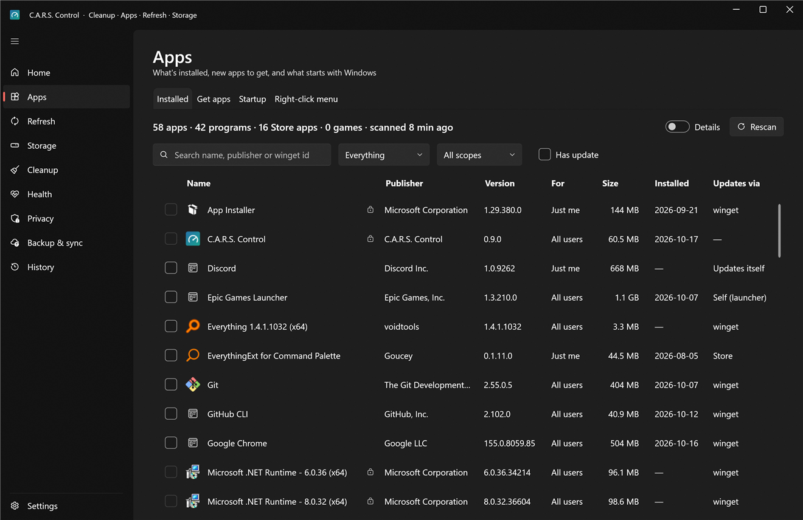
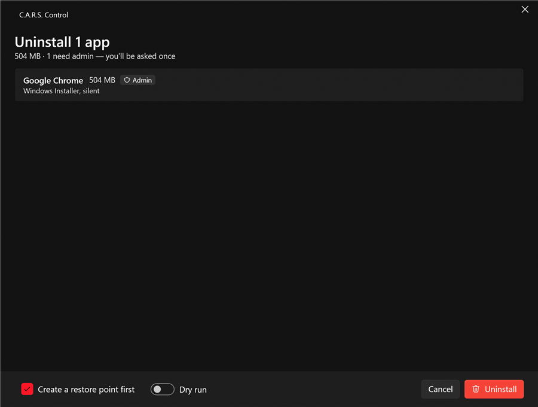
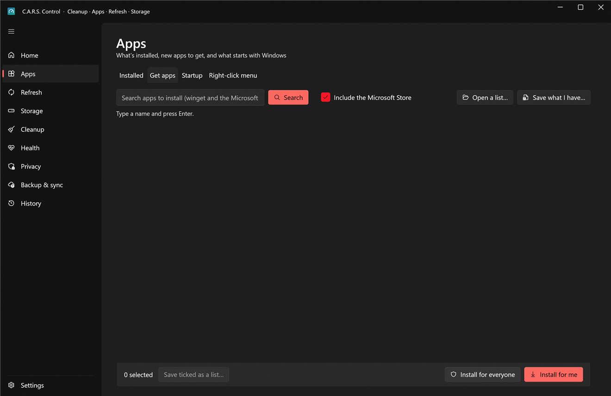
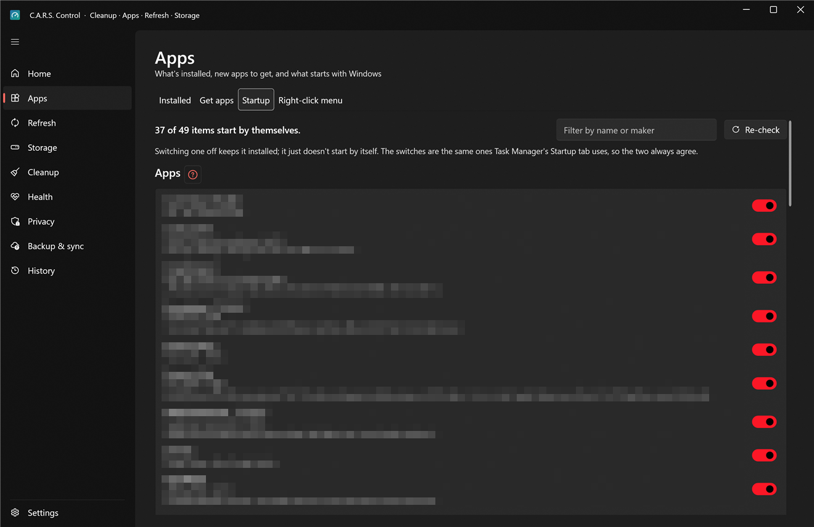
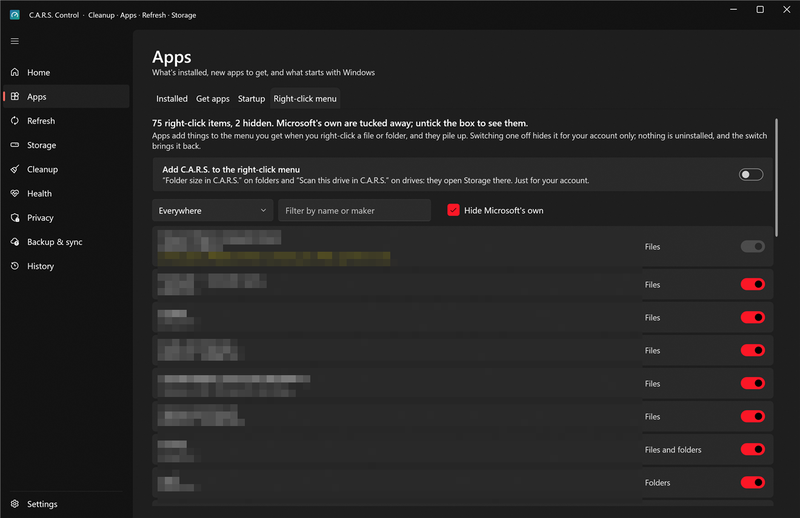

# Apps

Four tabs: **Installed**, **Get apps**, **Startup** and **Right-click menu**.

## Installed

Every app on the PC in one list, merged from the registry (all three views: per-user, machine-wide, 32-bit), Store/MSIX packages and winget, with the real size of each install folder.

* **Search** by name, publisher or winget id; the filter chips narrow to *Has update* and similar.
* **Sort** by name, publisher, version or size. Sizes are measured in the background and remembered.
* **Select an app** to see its details panel: where it's installed, what it installs *for* (you, or everyone), the way it updates, how it will be uninstalled, the winget id, and the last thing C.A.R.S. did to it.
* **Right-click** (or the buttons in the panel): **Update now** (when there's an update), **Uninstall…**, **Open install folder**, **Copy name**, **Copy winget id**, **Protect**.
* **Select several** (Ctrl- or Shift-click, or the checkboxes) and press **Uninstall selected** for a bulk uninstall.

### Uninstalling

**Uninstall…** opens a review before anything happens: what will be removed, in which order, and whether each step needs administrator approval. Then:

1. The app's own uninstaller runs, silently where it has a silent mode (otherwise its window appears and C.A.R.S. waits for it). Per-user apps are removed as **you**; machine-wide apps go through the admin helper.
2. C.A.R.S. **verifies** the result: the app's entry must have disappeared. A "success" that left the app in place is reported as a failure.
3. It then looks for **leftovers**: folders, registry keys and shortcuts the uninstaller didn't remove, in places that belong to that app only. Steam games also check shader caches, Workshop content and `LocalLow` save folders. You see the list; what you tick is **moved to quarantine**, not deleted, and can be restored from [History](history.md) for 30 days.

Apps that are **protected** are skipped by bulk uninstalls, and uninstalling one asks first.

### Protect

**Protect** guards an app against accidental uninstalls and bulk actions. The protected list is yours to edit in Settings › Protected apps.

## Get apps

Search for something to install without opening a terminal.

1. Type in the search box and press **Search**. It looks in the **winget** catalog; tick **Include the Microsoft Store** to add Store apps. Results are ranked (exact name first) and a language-pack or translation variant of an app sits below the real thing.
2. Pick one to see its publisher, versions, description, licence and website (**Open its website**).
3. Choose how to install it:
   * **Install for me**: just your account, no administrator prompt. The default for almost everything.
   * **Install for everyone**: machine-wide, for every account on the PC; this goes through the admin helper (one prompt).

   If an app only comes machine-wide, or only per-user, C.A.R.S. says so instead of failing with winget's cryptic code.
4. Progress and the result appear in the panel; the install is logged in [History](history.md).

### Lists: moving to a new PC

* **Tick several** results and press **Save ticked as a list…** to write a small `.json` of winget ids.
* **Save what I have…** writes the list of everything you currently have installed (apps winget knows about), a restore list for a new PC or a reinstall.
* **Open a list…** reads one back, lists every app on it, says how many are already here, ticks the rest and lets you install them in one go. Entries that aren't valid winget ids are skipped and counted.

The same list can travel in your [setup sync](backup.md#your-setup) so a second PC knows what you have. Ids in a list file are validated like anything else before anything is installed.

## Startup

What starts with Windows, in three groups. The switches are **the same ones Task Manager's Startup tab uses**, so the two always agree. Switching one off keeps the program installed; it just doesn't start by itself. Every change is remembered so you can switch it back.

* **Apps**: entries in the Run keys and Startup folders (yours and, with approval, the machine-wide ones, marked **admin**). Each shows its maker, what it starts, and whether it's on.
* **Services**: background programs that aren't from Microsoft. *Off* here means "start only when something needs it" (which is safe); right-click for **Disable completely…**, which asks you to confirm. Windows' own services are never listed.
* **Scheduled tasks**: tasks outside `\Microsoft\`. Same on/off.

Things this PC depends on are shown with a note and **can't be switched**: security software, VPNs (Proton, Tailscale), remote access, graphics driver controls, Salad and C.A.R.S. itself. **Filter** by name or maker; **Re-check** re-reads everything.

> **Tip:** switch off the startup apps you don't need *one at a time* and restart; that way you know which one a problem came from, and each is one click to undo.

## Right-click menu

Apps add entries to the menu you get when you right-click a file, folder, drive or empty space, and they pile up (and slow the menu down). This tab lists them with the app that added each one.

* Switching one **off** hides it **for your account only**; nothing is uninstalled and the switch brings it back. No administrator rights needed.
* **Hide Microsoft's own** keeps Windows' built-in entries out of the list, so what's left is third-party.
* Entries from **Nilesoft Shell** (or any other menu replacement that manages itself) are shown but locked: change those in their own settings.
* **Add C.A.R.S. to the right-click menu** adds, just for your account, **Folder size in C.A.R.S.** on folders and **Scan this drive in C.A.R.S.** on drives. They open [Storage › Explore](storage.md#explore) on that folder. Switch it off here to remove them.
