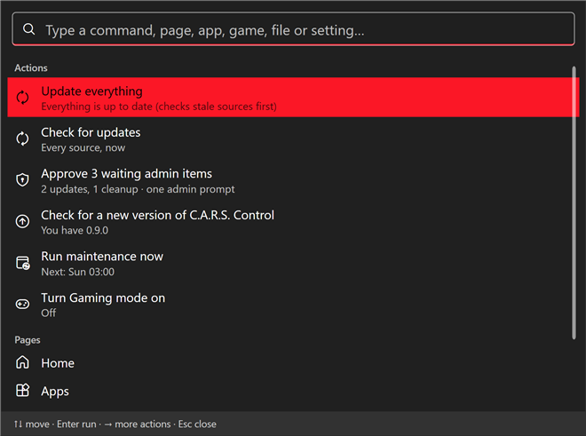

# Things that happen by themselves

Everything C.A.R.S. does in the background is listed here, with how to turn each one off. The rules never change: **nothing runs while you game, nothing shows a Windows administrator prompt while you're away, and nothing is installed or deleted that you haven't opted into.**

| What | Default | Where to change it |
|---|---|---|
| [Scheduled maintenance](#scheduled-maintenance) | On, Sunday 03:00 | Settings › Scheduled maintenance |
| [Gaming mode](#gaming-mode) | Automatic | Settings › Gaming mode |
| [Phone alerts](#phone-alerts) | Off (you set a topic) | Settings › Phone alerts |
| [Restart when I'm away](#restart-when-im-away) | Off | Health › Overview |
| [Backups](backup.md#backups) | Only the ones you create | Backup & sync › Backups |
| [Setup sync and status sharing](backup.md#your-setup) | Off | Backup & sync › Your setup |
| [Health watch](#the-health-watch) | Always on (cheap, skipped during games) | Alert limits in Settings › Health |
| Looking for a new C.A.R.S. version | Daily | Settings › About & updates |
| Update checks while idle | Per *Background work* | Settings › Background work |

## Scheduled maintenance

Updates and cleanup run **as you, while you're away**, on the days and time you pick (Sunday 03:00 by default).

* It starts only after you've been idle for a set time (default 5 minutes: no keyboard or mouse input and nothing full screen), and **never during a game**.
* **A run the PC missed** (it was off or asleep at 03:00) catches up **once**, after you've been idle for a few minutes, not the moment you sit down.
* Only the update sources and cleanup categories you choose run. Only updates that are **ticked by default** are installed: held drivers and ignored updates are left alone, and apps that are open are **skipped, never closed**.
* Each run is recorded in [History](history.md) ("Maintenance") and Home shows the last and next run. A failure appears on Home and, with phone alerts on, on your phone.

### The approval queue

Parts of a run need administrator rights (Windows Update, apps for all users, system cleanup). An unattended run **never puts a UAC prompt on an empty screen**:

* If an admin session is **already open** (you approved one earlier, or at sign-in for Gaming mode), the admin parts run.
* Otherwise they **wait in the approval queue**. When you're back, one toast with **Approve** appears (and a card on Home, and the tray), and **one prompt** runs everything that was waiting. **Dismiss** forgets them.

## Gaming mode

Turns on **by itself when a game starts**: any game from your Steam, Epic or other libraries (a five-second check), plus programs you add under *Also count as games*. Always-on Steam tools (Wallpaper Engine, SteamVR…) don't count. You can also switch it on by hand: Home, the tray or the palette.

While it's on:

* C.A.R.S. **pauses its own background work**: update checks, maintenance, the health watch and the backup schedule.
* With admin, it also **pauses Windows Update** (the way Settings does, with a 12-hour safety expiry; a pause you set yourself is left alone), **pauses Windows Search indexing** and **frees standby memory** (what ISLC does) at the start of the game.
* **Salad, your notifications and your power plan are never touched.**

It turns **off 30 seconds after the last game closes**: everything resumes, the session is logged in History (what was paused and for how long) and, if maintenance came due while you played, it runs once you've been idle.

**The admin part without a prompt mid-game:** with *Ask for admin once at sign-in* on, Windows asks for approval once about 20 seconds after you sign in, and that session stays open while you're signed in. Decline it and Gaming mode still pauses C.A.R.S.'s own work; the admin parts are skipped, and the session log says so.

## Phone alerts

Short messages to your phone through [ntfy](https://ntfy.sh): maintenance results and failures, admin items waiting, low disk space, a drive filling fast, **blue screens and unexpected shutdowns**, **drive health problems**, **a processor or graphics card staying too hot**, **a backup that failed**, and a weekly reminder when updates have waited a week.

* Messages carry **counts, drive letters and times only**: never file or app names, paths or error text.
* **Quiet hours** (default 23:00–08:00) hold everything except drive-health problems and a nearly full drive.
* Each alert type has its own switch. **Send test** checks the phone.
* The first real send is something *you* do (Send test). C.A.R.S. never sends anything before you've set a topic.

Setting it up step by step: [install guide](../install.md#phone-alerts-with-ntfy-iphone-and-android).

## Restart when I'm away

Windows updates often need a restart and then nag. On **Health › Overview** you can let C.A.R.S. finish it at a quiet time instead.

* It notices a **pending restart** (Windows Update, a driver, a pending file rename) and says what is waiting, and whether it's a minor reason.
* With **Restart when I'm away** on, it restarts the PC at **04:00 or later** (within three hours of that, one try per night), **only if you've been idle for 30 minutes**, you're not gaming and nothing is full screen. (The time and idle minutes are settings on the same card.)
* **A notification counts down five minutes first, with Cancel.** It uses Windows' own scheduled restart (`shutdown /r /t 300`), so you can also stop it yourself with `shutdown /a`.
* Unsaved work: apps are asked to close the normal way, as for any Windows restart; if one refuses, Windows' usual rules apply. Don't leave unsaved work open overnight if you turn this on.

## The health watch

Every 30 minutes (never during a game) C.A.R.S. makes a few **cheap checks**: pending restart, drive health, new blue screens or unexpected shutdowns, and (if you set limits) temperatures. Anything wrong goes to **Home**, and to your phone if you've turned that alert on. It reads Windows' own records; it doesn't scan files.

## The command palette

**Ctrl+K** in C.A.R.S. or **Ctrl+Alt+Space** from any program (changeable). Type part of anything: an action ("update everything", "clean", "gaming mode"), a page or tab, an app, a game, a big file, a setting. **Enter** runs the top result; **→** shows more actions for it (update, uninstall, open folder, play). What you pick most moves to the top; **Forget what I use most** (Settings › Command palette) resets that.

## What never happens by itself

* Anything that needs a Windows administrator prompt **while you're away or playing**.
* Installing or uninstalling an app you didn't choose, or closing an app that's open.
* Deleting documents, downloads, pictures or saves. (Cleanup touches caches and temp files; backups only add.)
* Changing a privacy switch, a startup entry, a service, a driver or a Windows Update setting. Those are always something you press.
* Sending anything off the PC except what's listed in [security.md](../security.md#7-what-it-connects-to).

To stop all background work at once: **Exit** from the tray icon, or switch off *Keep running in the tray* in Settings › Background work.
