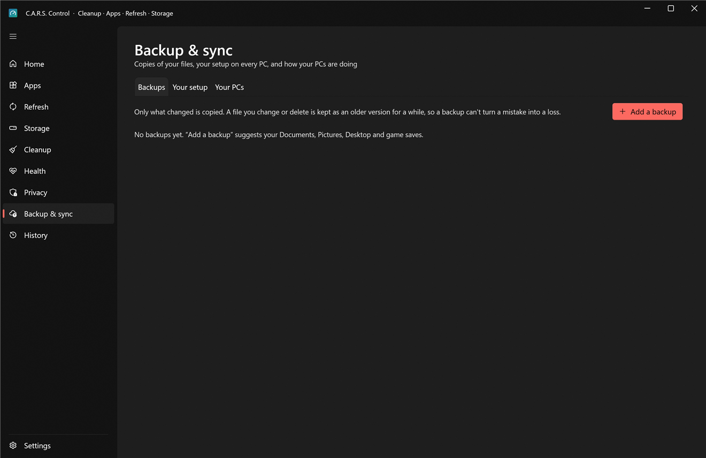
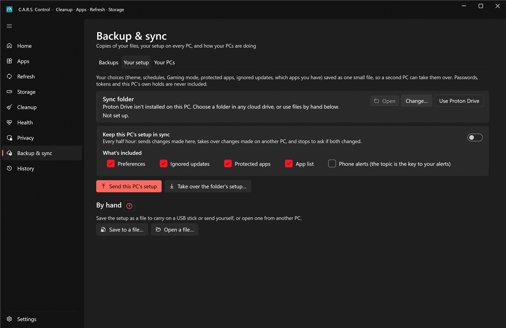
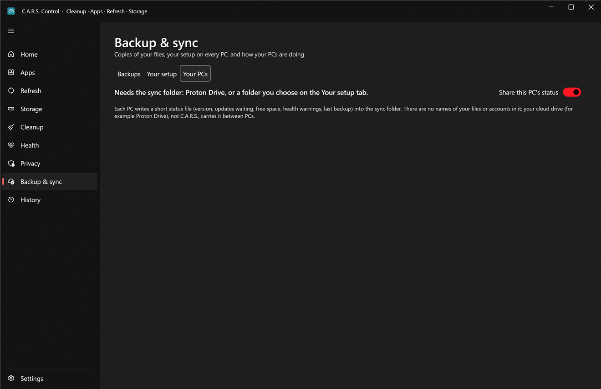

# Backup & sync

Three tabs: **Backups** (copies of your files), **Your setup** (your C.A.R.S. choices on every PC) and **Your PCs** (how each of your PCs is doing).

Everything here runs **as you** and never needs administrator rights: the folders it reads are yours. Nothing is sent to a server by C.A.R.S.: it reads and writes ordinary folders, and Proton Drive, OneDrive or whatever you use does the syncing.

## Backups

Press **Add a backup**. A form asks:

1. **What to back up.** It suggests your **Documents, Pictures, Desktop and Saved Games** (many games keep their saves there; **My Games** is offered too). **Add a folder…** for anything else. It backs up *folders*, never a whole drive, Windows or Program Files, and not a folder that contains the destination (or the other way round).
2. **Where it goes.**
   * **A folder.** Choose one **inside Proton Drive** for an encrypted off-site copy (C.A.R.S. finds your Proton Drive folder for you), or on another drive.
   * **A USB drive.** It's remembered by its **own volume ID, not its drive letter** (a USB stick gets a different letter every time). Whenever it's plugged in, the backup runs and a notification says **when it's safe to unplug**. If it isn't plugged in, the backup shows "isn't plugged in" instead of failing.
3. **Run every** N hours (default 24), and **keep older versions for** N days (default 30).
4. **Leave out** names or patterns, separated by commas (for example `*.tmp, node_modules`).

**Back up now** runs it immediately; otherwise it runs on its schedule **while you're away** (never during a game, never while something is full screen). Plugging in the chosen USB drive counts as "I'm here and I want it done", and runs it if the last one was over an hour ago.

### What gets copied, and how it's kept

* **Only what changed** is copied (comparing size and time), so the second run takes seconds.
* **It never deletes your backup.** A file you changed or deleted since the last run is **moved aside** into `.cars-versions\<yyyyMMdd-HHmmss>\…` inside the backup, and only those timestamped version folders older than your *keep* setting are removed. A backup therefore can't turn a mistake (or ransomware that encrypted a folder) into a loss for 30 days.
* **Cloud-only files are skipped**, not downloaded. A file another program has open is reported, not retried forever.
* **The backup is a plain copy**, in a folder named after the backup: `<the folder you chose>\<backup name>\<source folder>\…` (on a USB drive: `<drive>\C.A.R.S. Backup\<backup name>\<source folder>\…`). No special format: to **restore**, open that folder in Explorer and copy the file or folder back (older versions are in `.cars-versions`).

### Don't put your backup on the same disk as your files

If a source and the destination are on the **same physical disk**, a warning says so: when that disk fails you lose both. A good plan is *Proton Drive* for the important things plus a *USB drive* you keep somewhere else. (If your Desktop lives on another drive, as it does for some people, the warning accounts for that too.)

### Results

Each run's result is shown on its card (files copied, how much, how many versions kept, problems) and written to [History](history.md). **A backup that fails, or hasn't run in days, appears on Home and, if you've set up phone alerts, on your phone.**

## Your setup

Your C.A.R.S. choices as **one small file**, so a second PC can take them over, or so you can rebuild after a reinstall.

**What's included** (tick what you want to share):

* **Preferences**: theme, maintenance schedule, Gaming mode, command palette and so on.
* **Ignored updates**
* **Protected apps**
* **App list**: the apps you have installed (winget ids), so a new PC knows what to install.
* **Phone alerts**: the topic *is* the key to your alerts, so this one is off by default and only for your own PCs.

**Never included:** passwords and tokens, this PC's own *holds* (driver-update hold, crash evidence), the update repository setting and anything specific to one machine.

Two ways to move it:

* **Sync folder.** Choose a folder every PC can see (**Use Proton Drive** picks yours; **Change…** for another). With **Keep this PC's setup in sync** on, every half hour C.A.R.S. sends changes made here and **takes over changes made on another PC**, part by part: the newest wins, and **if both changed since the last sync it stops and asks** rather than guessing. It shows "synced from DESKTOP at 14:02".
* **By hand.** **Save to a file…** writes the setup to a file you carry on a USB stick or send yourself; **Open a file…** reads one from another PC. **Send this PC's setup** and **Take over the folder's setup…** do the same through the sync folder, once.

A setup file from the sync folder is treated as **untrusted**: only known settings are read, values are range-checked, and it can never change the update source, your token or anything outside the list above.

## Your PCs

A quick look at every PC that runs C.A.R.S. and shares a folder with you: **version, updates waiting, free space, health warnings, blue screens in the last 7 days and the last backup**. With **Share this PC's status** on, each PC writes a short `status-<PC name>.json` into the sync folder every 30 minutes (**no file names, no accounts**; Proton Drive, not C.A.R.S., carries it). A PC that hasn't reported for two days is marked stale.

It's a status board, not remote control: nothing on another PC can be changed from here.
