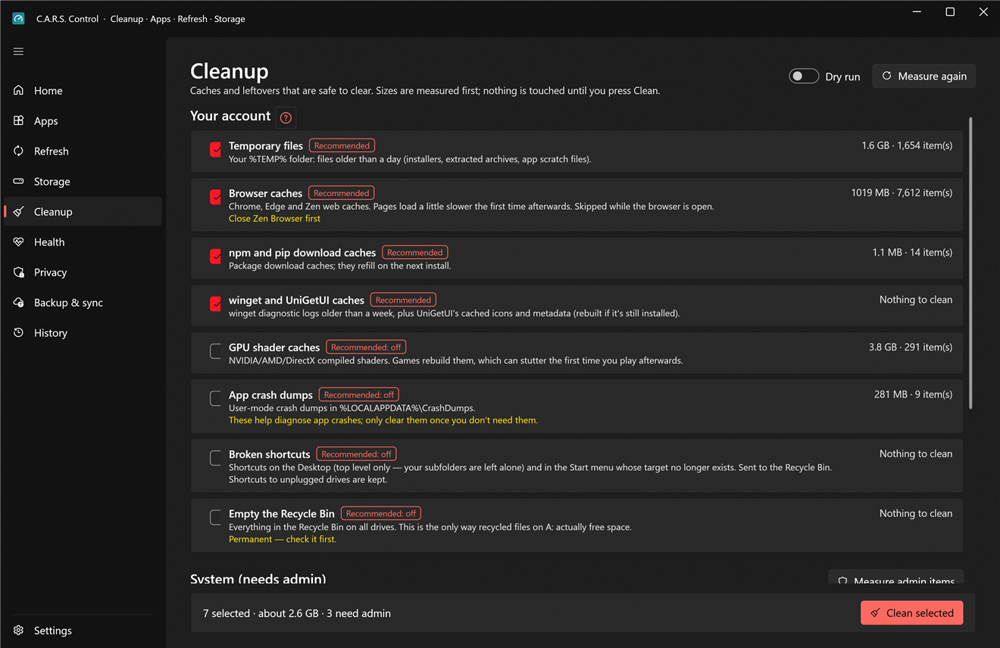

# Cleanup

Caches and leftovers that are safe to clear. **Everything is measured first**; nothing is touched until you press **Clean selected**. For the bigger, rarer things (duplicates, huge old files, a whole old Windows install) see [Storage](storage.md).

## Two groups

**Your account** (done as you, no prompt):

| Category | Ticked by default? |
|---|---|
| Temporary files | Yes |
| Browser caches | Yes |
| npm and pip download caches | Yes |
| winget and UniGetUI caches | Yes |
| GPU shader caches (rebuilt when games launch, so the first launches are slower) | **No** |
| App crash dumps | **No** (they are evidence; see below) |
| Broken shortcuts | **No** |
| Empty the Recycle Bin | **No** |

**System (needs admin)**, done through the admin helper with one prompt; press **Measure admin items** to see their sizes first (that also asks once):

| Category | Ticked by default? |
|---|---|
| Windows temporary files | Yes |
| Delivery Optimization cache | Yes |
| Windows Update cleanup (component store) | **No** (it's slow, and removes the ability to uninstall old updates) |
| Windows error reports | Only if you don't keep crash evidence |
| System crash dumps (BSOD) | **No** (evidence; see below) |

## How to use it

1. Open the page; sizes are measured for you. **Measure again** re-reads them.
2. Untick anything you want to keep. Each row says what it is, how big, and what happens when you clean it.
3. **Dry run** (switch at the top) shows what *would* be deleted without deleting.
4. **Clean selected.** Progress is shown; the result and the space freed go to [History](history.md). Files that are in use are skipped and reported, not forced.

## Crash evidence

If you're chasing a blue screen or a crash, Settings › This PC has **Keep crash evidence**. While it's on, crash dumps and Windows error reports are never ticked, so a cleanup can't throw away the thing you need to find out what's wrong. (They stay out of the way even when you press **Update everything** on Home.)

## What Cleanup never touches

Documents, downloads, pictures, game saves, app settings, anything in a cloud-synced folder, other users' files (without admin approval) or anything it hasn't measured.
