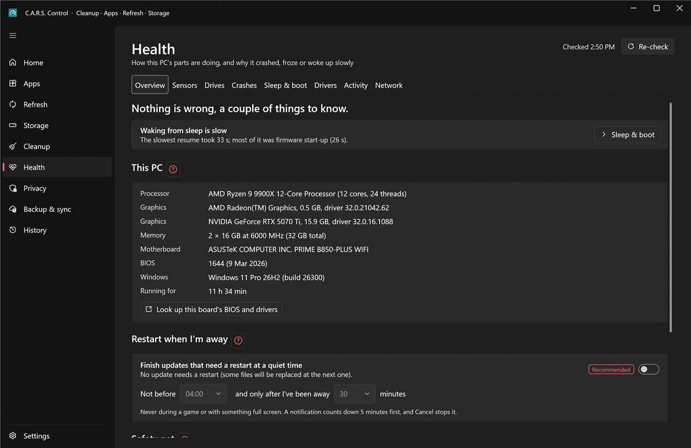
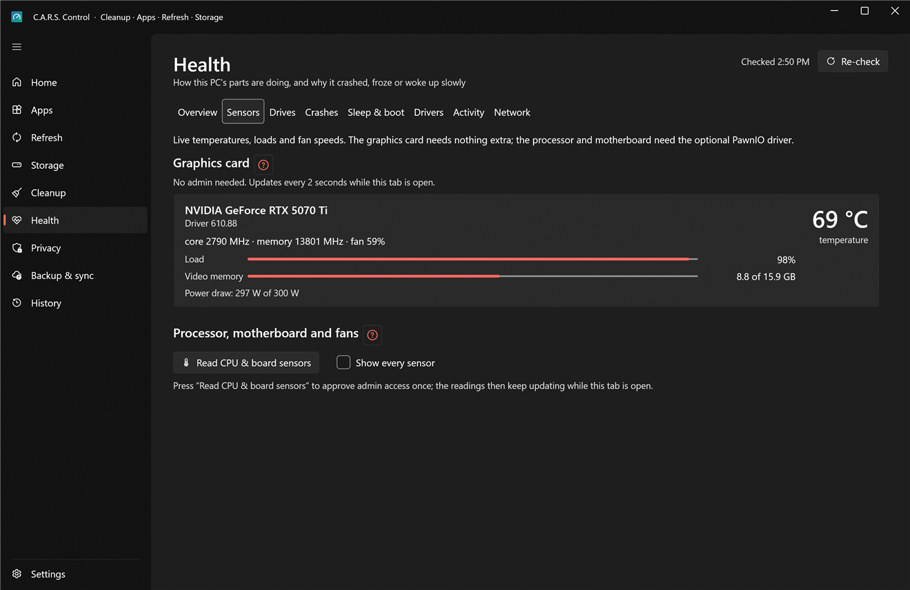
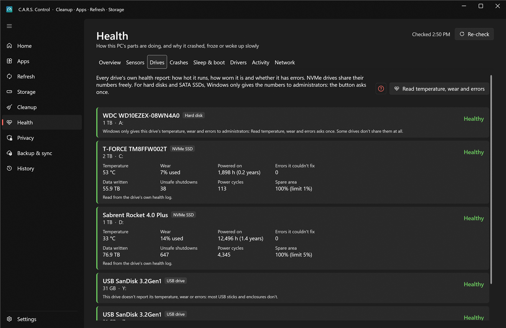
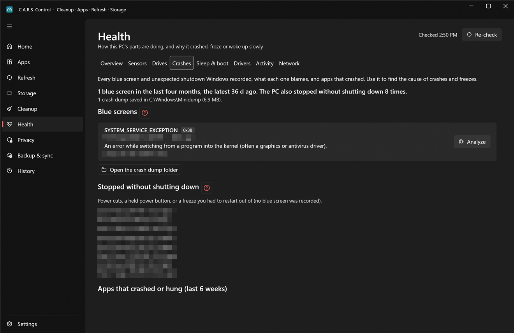
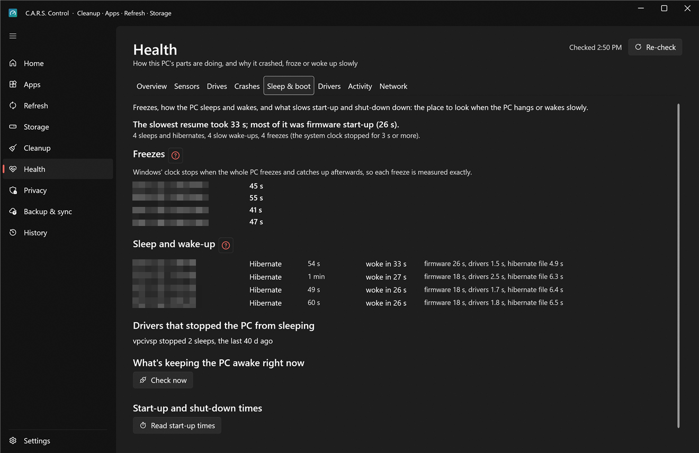
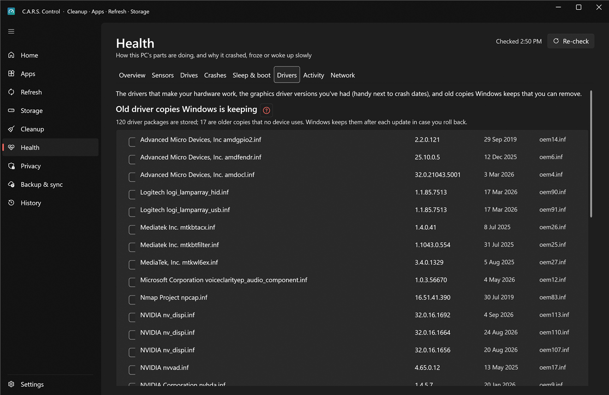
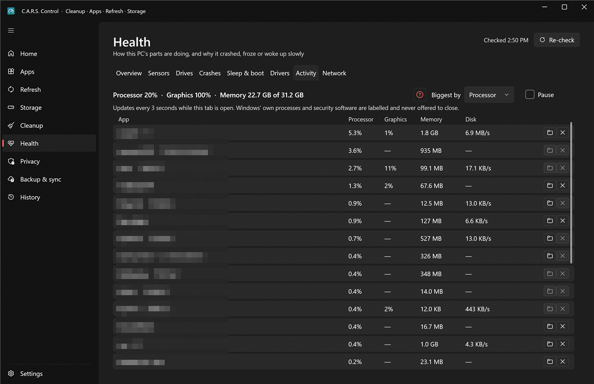

# Health

Is this PC healthy, and if it isn't, what is wrong? Eight tabs: **Overview**, **Sensors**, **Drives**, **Crashes**, **Sleep & boot**, **Drivers**, **Activity** and **Network**.

Most of it is read-only and needs no administrator rights. The few things that do (drive counters, boot times, the motherboard sensors, removing old driver packages) say **admin** and ask once per session. The page keeps a 30-minute watch in the background (a few cheap reads, never during a game) so that something wrong reaches [Home](home.md) or your phone without you opening this page.

## Overview

* **A headline and the findings.** What, if anything, needs attention across all the tabs: a drive reporting problems, recent blue screens, freezes, a driver that stops sleep, a hot component. Each finding has a button that opens the tab with the details.
* **This PC.** CPU, graphics card (the real one: virtual display adapters from Parsec or Virtual Desktop are skipped), memory modules, motherboard, BIOS and its date, Windows edition and build. **Look up this board's BIOS and drivers** opens a web search for your board in your browser (C.A.R.S. itself sends nothing).
* **Battery** (laptops and tablets only): charge, whether it's charging, and how much of its original capacity it still holds.
* **Restart when I'm away.** See [Automation](automation.md#restart-when-im-away).
* **Safety net.** A **restore point is made before risky changes**: removing old drivers, installing a driver or feature update from Windows Update, and applying privacy switches that need admin. It needs Windows' System Protection to be on for `C:`; if it isn't, this card says so and **Turn on System Protection** does it. (Windows creates at most one restore point every 24 hours by default, so a very recent one may stand in for a new one.)
* **Share a report.** **Save report…** writes **one web page** with these specs, drive health, temperatures, crashes and sleep problems, for a forum post or a repair shop. It's saved as a file; nothing is sent anywhere. Tick *Remove my user name, this PC's name and folder paths* before sharing it.

## Sensors

* **Graphics card** (NVIDIA): temperature, load, clocks, fan, power and video memory, refreshed every 2 seconds while the tab is open. **No admin needed.**
* **Processor, motherboard and fans.** Windows doesn't let normal programs read these, so a small kernel driver, **PawnIO**, is needed. It's optional: the first time, **Install PawnIO** downloads one specific release, checks it against a SHA-256 fixed in the app, and installs it after one admin prompt ([why this is safe, and what the risk is](../security.md#11-honest-limits)). Then **Read CPU & board sensors** shows a **summary** (CPU temperature, CPU power and load, motherboard temperature and the fans that are spinning) and the full list below it.
* Impossible readings (below 5 °C or above 125 °C) and fan headers with nothing connected (0 RPM) are hidden; **Show every sensor** shows them too.
* Sensor names come from LibreHardwareMonitor where it knows them. Generic motherboard channels are labelled as unassigned temperature probes or fan headers with unknown connections: C.A.R.S. doesn't guess which fan or part a generic channel measures.

Temperatures only cost anything while this tab is open and the window is showing (polling stops when you switch tabs or hide to the tray) (or once a minute if you've set temperature alerts in Settings › Health, which warn you, at most every six hours, when the processor or graphics card *stays* above the limit).

## Drives

Windows' own health status for each physical drive, plus the numbers the drive keeps about itself, read from its own health log:

* **NVMe SSDs** share them without admin: **temperature** (and the drive's own limit), **wear** (% of the rated endurance used), **power-on hours**, **errors it couldn't fix**, **data written**, **unsafe shutdowns** (power lost or a forced restart), **power cycles** and **spare area**.
* **Hard disks and SATA SSDs** only give them to administrators: **Read temperature, wear and errors** asks once, then adds hours, temperature, and reallocated or pending sectors (the early signs of a failing disk).
* **USB sticks and many USB enclosures** don't report wear at all; the card says so instead of showing a made-up 0%.

Every value has a tooltip saying what it means and what's good or bad. A drive reporting a problem (a critical warning, spare area below its limit, errors it couldn't fix, bad sectors) raises a phone alert (if you've set those up), at most once a day per drive, and appears on Home.

## Crashes

* **Blue screens.** Every blue screen on record, with the stop code (e.g. `0x3B SYSTEM_SERVICE_EXCEPTION`), when it happened, and whether a crash dump was kept. Select one and press **Analyze** to find out what it blames.
  * Analysis uses Microsoft's own debugger, **WinDbg**. If it isn't installed, **Install WinDbg** installs Microsoft's debugger from winget for your account after you confirm (about 200 MB, no administrator prompt). It reads the dump (never runs anything from it), asks you to confirm, downloads the symbols it needs from Microsoft's symbol server the first time (about 100 MB, cached; the server learns the names and versions of the Windows files in the dump, not your files), and reports the **module** the crash points at and the failure bucket. The result is remembered, so the next look is instant.
  * Windows only lets administrators read the dumps in `C:\Windows\Minidump`, so the first **Analyze** asks once: the admin helper copies that one dump (it accepts only a real minidump file name, up to 256 MB) into `C:\ProgramData\CarsControl\dumps`, readable by you only, and copies older than 30 days are removed. If the debugger still can't read it, its own error is shown instead of a vague message.
  * Results sit beside the **NVIDIA driver versions** on the Drivers tab, so you can see whether crashes started after a driver update.
  * **Open the crash dump folder** shows `C:\Windows\Minidump` in Explorer.
* **Stopped without shutting down.** Power cuts, a held power button, or a freeze you had to restart out of: no blue screen was recorded, but Windows noticed the PC didn't shut down cleanly.
* **Apps that crashed or hung** in the last six weeks, grouped by app, with how often.

## Sleep & boot

* **Freezes.** When the whole PC freezes, Windows' clock stops and catches up afterwards, so each freeze is measured exactly (how long, when). A pattern around gaming, sleep or one driver stands out here.
* **Sleep and wake-up.** Each time the PC went to sleep and woke up, whether you used the power button or Windows chose to, how long waking took, and what woke it.
* **Drivers that stopped the PC from sleeping.** Windows logs when a driver refuses to let a power transition finish; this lists them.
* **What's keeping the PC awake right now.** **Check now** asks Windows (admin, once) which programs and drivers are holding sleep off.
* **Start-up and shut-down times.** **Read start-up times** (admin, once) shows recent boots and sign-ins, **what slowed them down** (the slowest apps and drivers) and shut-down times.

## Drivers

* **Old driver copies Windows is keeping.** Windows keeps every older version of a driver in its *driver store*, often gigabytes of it. This lists the copies that are **older than the newest of the same driver and not used by any device**. **Tick all** or choose, then **Remove ticked**: it asks to confirm, makes a restore point first, and removes each through the admin helper, which re-checks on its own that the copy is old and unused (and Windows itself refuses if it still needs it). You can't roll back to a removed copy afterwards.
* **NVIDIA graphics driver versions on this PC**, with the dates each was built, to compare with the blue screens on the Crashes tab.
* **Every driver**: device, version, date, maker and whether it's signed. Filter by device, maker or version.

## Activity

**What's using my PC right now?** The top programs by **Processor**, **Graphics**, **Memory** or **Disk** (pick under *Biggest by*), refreshed every 3 seconds while the tab is open (**Pause** freezes the list). Each row shows the program, **which app it belongs to** (from your inventory), and has **Open folder** and **End**.

* **End** asks first ("anything unsaved in it is lost"), then closes the program. It's for the runaway program, not Windows.
* **Protected programs** (Windows' own, security software, remote access, and **Salad's** processes) are labelled and **never offered to end**. Salad is labelled "Salad: your earnings", because that's what it is.

## Network

The Proton VPN and Tailscale cards (and the VPN chip on Home) only appear on PCs that have those apps; without either, this tab shows your network connections.

* **Proton VPN.** Whether it's connected and, more importantly, whether it's **carrying your internet traffic** (some setups show "connected" while traffic still leaves another way). **Re-check** reads it again. A chip on Home shows the same.
* **Tailscale.** Whether it's up, your other devices ("peers") and whether each reaches this PC **directly or through a relay**, and an explanation if it can't go direct: a **strict NAT** (common behind a VPN) forces relays. **Test direct connections** runs Tailscale's own network check and shows the nearest relay and latency.
* **Your other devices.** Pick a **Test port** (22, 445, 3389, 80 or 443) and each peer row can **test** it with a plain TCP connection (never a ping), so you can tell "the device is off" from "the service isn't running".
* **Exit node safeguard.** If this PC offers itself as a Tailscale exit node, it should do so only while Proton VPN is carrying traffic; this card tells you if that's not the case, so a phone using it can't leave through your normal connection.
* **Connections on this PC.** Every network adapter with its state and speed, and an arrow on the one internet traffic actually leaves through.

> The Network tab only reads local state (Windows' network info and the `tailscale` command, if it's installed). It never changes your VPN or Tailscale settings.
