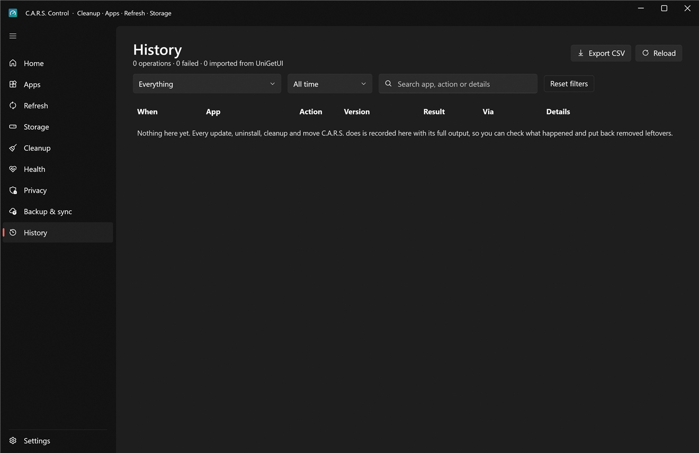

# History

Every operation C.A.R.S. performs, with its **full output**, so you can always answer "what happened, and when?". It's also where you **restore** things.

## What's recorded

One row per operation: **Update**, **Install**, **Uninstall**, **Cleanup**, **Leftovers**, **Maintenance** (a scheduled run), **Gaming** (a session), **Privacy**, **Health** (driver removal, System Protection and so on), **Startup**, **Backup** and **Sync**. Each row has the app or item, the version change where it applies, the result (succeeded, failed, skipped, cancelled, dry run), a one-line summary and, when you select it, the complete output underneath, including what an installer said and the exit code.

If you used UniGetUI, its history can be imported once (Refresh or Settings) and appears alongside.

## Finding things

* **The first dropdown**: *Everything*, *Failures only*, or *C.A.R.S. only* (hides imported UniGetUI history).
* **Kind chips** (Update, Cleanup, Uninstall…): pick one or several to show only those. Only kinds that exist in your history appear.
* **Range**: all time, today, the last 7, 30 or 90 days.
* **Search** matches the app, the action and the details.
* **Reset filters** clears all three.
* **Export CSV** saves what's currently shown (with your filters applied) as a spreadsheet; **Copy** copies the selected output.
* **Reload** re-reads the list (it also updates by itself while operations run).

## Restoring leftovers

When you uninstall an app, the leftovers you chose were **moved to quarantine, not deleted**. Select the uninstall row and press **Restore these leftovers** to put them back exactly where they were. You have **30 days**, after which the quarantine is emptied.

**Find leftovers…** works for an app you uninstalled *before* (or outside) C.A.R.S.: choose it and it looks for what such an app typically leaves, then offers the same quarantine step.

## Failures

A failed row says **why in plain English** at the top of its details ("the installer is still in use", "Windows needs a restart first", "not found for this account") with the raw output below it. Failures that happen while you're away also show on [Home](home.md), and on your phone if you've set up alerts.
