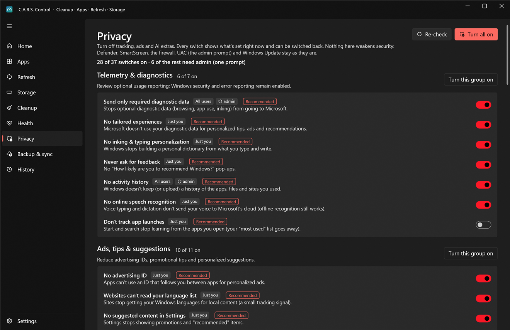

# Privacy

Turn off tracking, ads and AI extras. **Every switch shows what's set right now** (it reads Windows, not its own notes), and **every change can be undone exactly**.

> **What this page never does:** it never touches Windows Defender, SmartScreen, the firewall, UAC, Windows Update or Windows Error Reporting (crash reports are evidence you may want). Nothing here weakens your PC's security.

## The switches, in seven groups

There are 38 in all; a few appear only where they exist (Recall and Click to Do on Windows 11 24H2 and newer, the Chat button on older Windows 11, the Office ones only if Office is installed), so most PCs see 35 to 37.

| Group | Switches |
|---|---|
| **Telemetry** (7) | Send only required diagnostic data · no tailored experiences · no inking & typing personalisation · never ask for feedback · no activity history · no online speech recognition · don't track app launches |
| **Ads** (11) | No advertising ID · websites can't read your language list · no suggested content in Settings · no tips and promoted apps in Start · no tips and suggestion notifications · no welcome experience after updates · no fun facts and tips on the lock screen · no suggested apps installed silently · no OneDrive and Microsoft 365 ads in File Explorer · no account nags in Start · no suggested notification settings |
| **AI** (6) | Turn off Windows Copilot · no Copilot button on the taskbar · no Recall snapshots · no Click to Do · no AI features in Notepad · no AI features in Paint |
| **Search** (4) | No Widgets (news feed) · no weather and news on the lock screen · no Bing results in Start search · no search highlights |
| **Edge** (4) | No shopping assistant and Rewards · no Copilot sidebar · no recommendations and personalisation · Edge sends no optional diagnostic data |
| **Office** (3) | No optional connected experiences · Office doesn't analyse your content · Office sends only required diagnostic data |
| **Taskbar** (3) | No Task View button · no Chat (Teams) button · search as an icon, not a box. These are preferences, not privacy, so **Turn all on** leaves this group alone. |

Switches that only change **your account** are applied by the app as you, with no prompt. Ones that are machine-wide policies (Copilot, Recall, Edge, Office…) go through the admin helper, one prompt for the whole batch. Your own policy settings are written to *your* registry hive, never the administrator's.

## Using it

* **Turn all on** applies every switch except the Taskbar group; **Turn this group on** applies one group. Both make a restore point first if System Protection is on (you'll see it in History).
* Each row has its own toggle: on means *the privacy-friendly setting is applied*. A switch can also read **Partly** if only some of its values are set.
* **Windows default** puts a switch back to what a fresh Windows has.
* **Undo** (the toggle going off) restores **exactly what was there before C.A.R.S. changed it**, not a generic default; the first value is remembered the first time you change a switch.
* **Re-check** re-reads the state of everything (use it after a big Windows update, which sometimes resets things).

Some switches only take full effect after you sign out or restart; the row says so.

## Apps that came with Windows

A list of the Microsoft Store apps that ship with Windows and aren't essential: Copilot, Bing Search, News, Weather, the Microsoft 365 hub, Clipchamp, Tips, Get Help, Feedback Hub, Solitaire Collection, Dev Home, Power Automate, To Do, the new Outlook, Teams (free) and Media Player. **Remove** uninstalls one **for your account only**: nothing changes for other users, and classic Outlook or Office are not affected. Changed your mind? Under **Not installed**, click an app to open its page in the Microsoft Store.

## Who used your camera, microphone and location

Read straight from Windows' own record (Settings › Privacy & security › Recent activity). It's **read-only and never leaves this PC**. Handy for spotting an app that uses the microphone more than it should.

## Things to know

* The first time a change needs Windows to apply policy, Settings may say "Some settings are managed by your organization". That's how Windows reports any policy; it isn't an organisation.
* If you uninstall C.A.R.S., **the switches stay as you left them**. Switch them back first (or use **Windows default**) if you want Windows' defaults.
