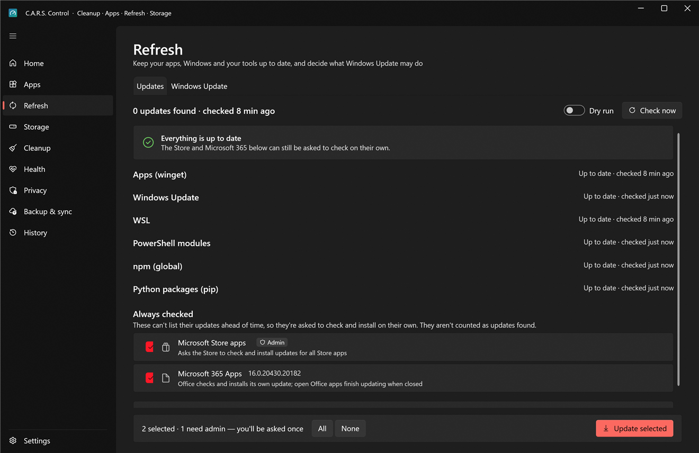
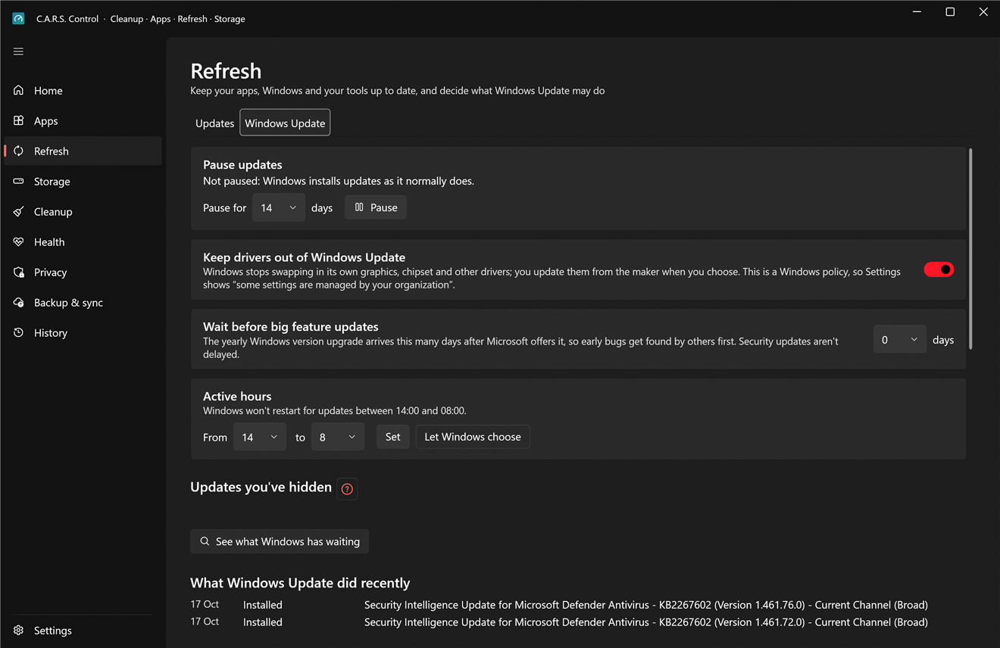

# Refresh

Two tabs: **Updates** (everything that can be updated) and **Windows Update** (what Windows itself may do, and when).

## Updates

Press **Check now** to ask every source what's out of date, in parallel:

| Source | What it covers | Runs as |
|---|---|---|
| **winget** | Apps from winget's catalog and the Microsoft Store, per-user and machine-wide | You for per-user apps; the admin helper for machine-wide ones |
| **Windows Update** | Windows, drivers, Defender definitions, .NET | Admin helper |
| **WSL** | `wsl --update` | Admin helper |
| **PowerShell modules** | Modules from the PowerShell Gallery | You |
| **npm** | Global packages | You |
| **pip** | Python packages (your `--user` packages as you; machine-wide ones through the helper) | You / helper |
| **Microsoft Store / Microsoft 365** | Can't list updates ahead of time, so they're simply *asked* to check and install on their own; listed under **Always checked** and not counted as updates found | You |

Each row shows the app (with its icon), the old and new version and a **What's new** link where the publisher gives one. Rows that need administrator rights are marked **Admin**.

### Installing

* Rows are ticked by default when it's safe: **not** pip upgrades (they can break a project's environment) and not anything your *This PC* holds cover (driver updates while "hold back driver updates" is on).
* Press **Update selected**. All admin rows share **one** prompt; per-user rows never prompt.
* **Dry run** shows what would run for each row without running it.
* **Stop after this one** finishes the current update and leaves the rest.
* "Done means gone": a finished update leaves the list (it's in [History](history.md)) and returns only if a later check finds a newer one. And it's **verified**: the version must have changed and the app still be there.
* Failures are explained in plain English ("the installer is in use: close the app and try again") with the raw output one click away.

### When an update "succeeds" but nothing changed

Sometimes winget's catalog is simply wrong: its entry says version *1.142.0* but the installer it downloads is still *1.141.2* (this happened with Visual Studio Code). The installer runs fine, the version doesn't change, and nothing on your PC is at fault. C.A.R.S. reads winget's installer log, notices the mismatch and says so in plain English. The row is marked **Not updated** and offers:

* **Skip this version**: hide it until winget's catalog offers a newer one.
* For apps that update themselves (VS Code, Chrome, Edge, Firefox, Brave, Discord, Slack, Spotify, Zoom, Notion, Cursor, Obsidian), how to use **the app's own updater** instead.

Scheduled maintenance remembers a broken catalog version and doesn't retry it every week; it waits for a newer one.

### Skipping and ignoring

Right-click a row:

* **Skip this version** hides that one version; the next release shows up again.
* **Ignore updates permanently** stops offering updates for that app at all. The **Ignored updates** list at the bottom (and Settings › Ignored updates) shows everything ignored, with **Stop ignoring**.

### Launchers are left alone

Steam, Epic, EA, Ubisoft, Rockstar and Riot launchers update themselves, and re-running their installers through winget can break them, so they're excluded.

### Coming from UniGetUI

If you used UniGetUI, a card offers to **Import** its ignore rules and update history once; *No thanks* dismisses it for good.

## Windows Update

Windows updates itself on its own schedule, which is usually right, and occasionally the wrong moment or the wrong driver. This tab puts the controls that Settings hides or lacks in one place. All of it is reversible: **Resume updates** and **Let Windows choose** put everything back.

* **Pause updates**: choose days (up to 35) and press **Pause**; **Resume updates** ends it. Gaming mode uses the same mechanism for a few hours; while that's active this control tells you to wait.
* **Keep drivers out of Windows Update**: Windows stops swapping in its own graphics, chipset and other drivers, and you update them from the maker when you choose. It's a Windows *policy* (Settings will say "some settings are managed by your organization").
* **Wait before big feature updates**: the yearly Windows version upgrade arrives this many days after Microsoft offers it (0–365), so early bugs get found by others first. **Security updates aren't delayed.**
* **Active hours**: the hours Windows won't restart for updates. **Let Windows choose** returns it to automatic.
* **See what Windows has waiting** lists the updates on offer. **Hide** one (Windows then never offers it again) and find it later under **Updates you've hidden**, where **Show again** undoes it.
* **What Windows Update did recently**: the last installs and failures, readable without administrator rights.

All the changes go through the admin helper (one prompt), each validated and limited to the values in the list above.

> Pausing Windows Update delays *security* fixes too. A week or two is reasonable while chasing a problem; leaving it paused for a month is not.
