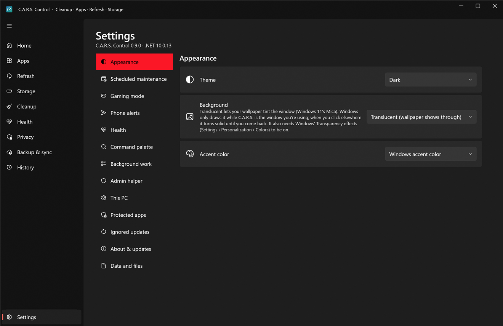
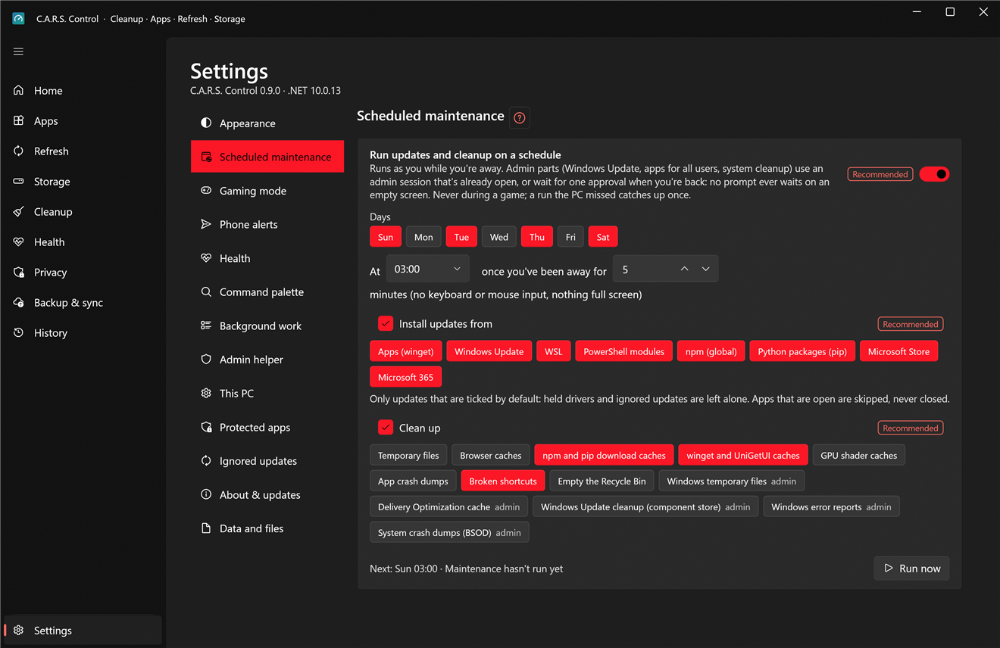
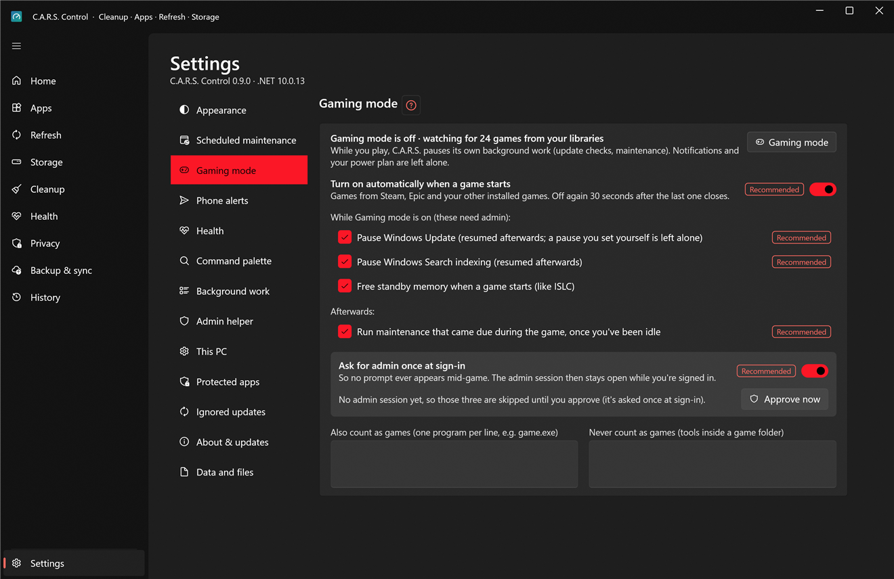

# Settings

Settings has a list of sections on the left and one section at a time on the right. **Ctrl+K** finds any setting by name, and links elsewhere in the app (Home, the tray) take you straight to the right section.

**This PC** selects Desktop, Laptop or Gaming-first recommendations. **Apply recommended settings…** previews the changes and can undo the exact previous values during this session. After completing first-time setup, **Undo first-time setup choices** restores the saved setup settings and original start-at-sign-in command; privacy switches keep their own undo controls.

## Appearance

* **Theme**: dark, light, or follow Windows.
* **Background**: translucent (the wallpaper shows through, the Windows 11 *Mica* look) or solid.
* **Accent color**: the C.A.R.S. teal, your Windows accent, or a custom color. Changes apply immediately.

## Scheduled maintenance

Run updates and cleanup on a schedule, by default **Sunday at 03:00**. It runs **as you while you're away** (after you've been idle for a set number of minutes, nothing full screen, never during a game). Choose **Install updates from** (which sources) and **Clean up** (which categories). Only updates that are ticked by default run: held drivers and ignored updates are left alone, and apps that are open are skipped, never closed. **Run now** does it immediately. See [Automation](automation.md#scheduled-maintenance).

## Gaming mode

* **Turn on automatically when a game starts**: games from Steam, Epic and your other installed games; off again 30 seconds after the last one closes.
* While on, C.A.R.S. pauses its own background work. With admin, it can also **pause Windows Update** (resumed afterwards, and a pause you set yourself is left alone), **pause Windows Search indexing**, **free standby memory** when the game starts (like ISLC) and **run maintenance that came due during the game** afterwards.
* **Ask for admin once at sign-in** so no prompt ever appears mid-game; **Approve now** does it right away.
* **Also count as games** / **Never count as games**: programs by name, for anything the automatic detection gets wrong. (Always-on Steam tools such as Wallpaper Engine are already excluded.)
* Salad, notifications and your power plan are left alone. See [Automation](automation.md#gaming-mode).

## Phone alerts

Send short messages to your phone with [ntfy](https://ntfy.sh). **Alerts contain counts, drive letters and times only, never file or app names, paths or error text.**

* **Topic**: a random name, shown as a QR code; it's the only key to your alerts, so keep it to yourself. **Copy**, or **New topic** to replace it. Install the free ntfy app on your phone, scan the code with the camera, copy the text, tap **+** in ntfy and paste it as the topic.
* **Name for this PC in alerts** helps if you have several.
* **Server** (https only) and an **access token** (stored encrypted for your Windows account) for your own ntfy server.
* **Tell me about**: scheduled maintenance results · failures · admin items waiting for your approval · blue screens and unexpected shutdowns · drive health problems (always sent) · the processor or graphics card running hot · low disk space (under N GB and under 10% of the drive) · a drive filling fast · a weekly reminder when updates have waited a week.
* **Quiet hours** hold alerts and send them when they end; drive health and a nearly full drive still come through.
* **Send test** sends one message so you can check the phone.

## Health

* **Temperature alerts**: limits for the processor and graphics card (default 90 and 85 °C); they must stay above the limit for several readings and you hear about it at most once every six hours.
* **Read the processor and motherboard sensors** on the Health › Sensors tab (needs the PawnIO driver and one admin approval).
* **Make a restore point before removing old drivers, driver and feature updates, and privacy batches** (when System Protection is on).

## Command palette

* **Ctrl+K** inside C.A.R.S., plus a shortcut that works **from any program** (default **Ctrl+Alt+Space**; click the box and press the keys you want; **Reset** puts it back).
* **Forget what I use most** clears what the palette has learned to put first.

## Background work

* **Keep running in the tray and check for updates**, and **Check every (hours)**.
* **Start with Windows (minimised to the tray)**: sets your own startup entry; nothing is installed system-wide.

## Admin helper

How long the admin helper may sit idle before it closes (default 15 minutes), and **Test admin helper** to check that it starts and answers. Windows asks for an administrator's approval once per session. See [Security](../security.md).

## This PC

Temporary **holds** for whatever is going on with this PC, each with a reason that shows where it applies:

* **Hold back driver updates**: Windows Update drivers are listed in Refresh but not ticked.
* **Keep crash dumps and error reports**: Cleanup leaves them unticked, since they're the evidence for diagnosing blue screens.

## Protected apps

Apps whose name **starts with** any line here show a lock and can't be ticked or uninstalled (updates still run). One per line. **Reset to defaults** gives the basic list: runtimes, drivers and C.A.R.S. itself.

## Ignored updates

Everything you've chosen not to be offered, each with **Stop ignoring**, and **Import from UniGetUI** if you used it.

## About & updates

* The installed version, **Check now**, and **Update now** when a newer one is ready (see [updating](../install.md#6-updating)); **Skip this version**; **Release page**.
* **Look for updates automatically**: once a day, never while you play. Nothing installs without you pressing *Update now*.
* **Also offer pre-releases (release candidates)**.
* **Where updates come from**: a GitHub repository (`owner/name`) checked over HTTPS, or through the GitHub CLI while the repository is private. Change it only to follow a fork.
* **Help and source**: **Project page**, **Report a problem** (opens a bug report in your browser with the version, Windows build and .NET version filled in; you read it and decide whether to submit it), **Copy diagnostics** (the same details, to paste yourself) and **Run the first-time setup again**.
* When something goes wrong, the error message offers **Report it**: the same bug report with the error filled in. Your user name, PC name, folder paths and e-mail addresses are removed first, and nothing is sent unless you submit it on GitHub. C.A.R.S. has no telemetry.

## Data and files

Where your settings, history and logs live, with **Show** / **Open** buttons for each (see [where everything lives](../install.md#9-where-everything-lives)).
