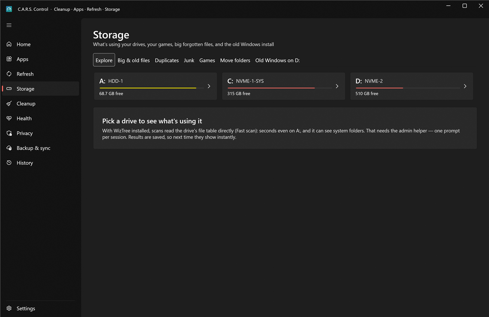
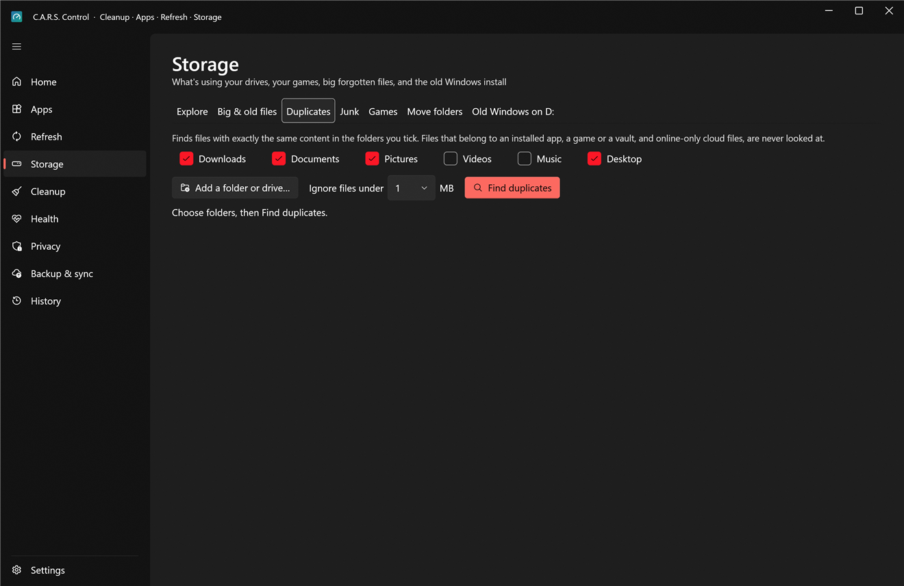
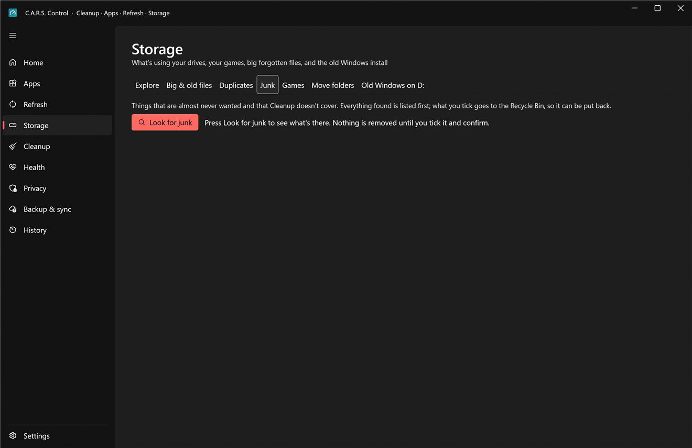
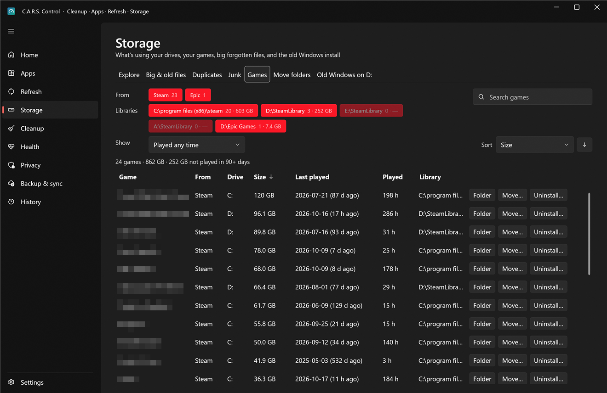
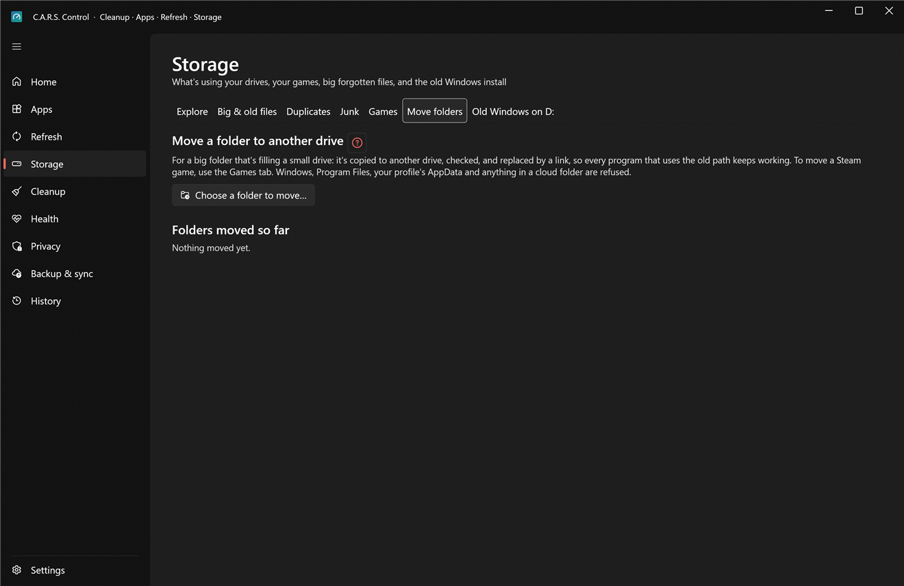
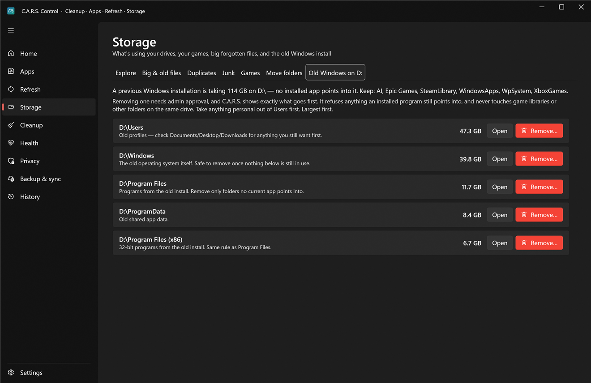

# Storage

What's using your drives, and what you can safely do about it. Seven tabs: **Explore**, **Big & old files**, **Duplicates**, **Junk**, **Games**, **Move folders** and **Old Windows**.

Space is measured **on disk**: a file that only exists in the cloud (iCloud Drive, OneDrive, Proton Drive "online-only") takes no space and isn't counted.

## Explore

Pick a drive (the drive cards show used and free space) and see what's in it as a **treemap**: bigger rectangle, bigger folder. Double-click a folder to go in; the list underneath shows the same folders with size, share and file count.

* **Back / Forward** with the mouse side buttons or **Alt+←/→**; **Backspace** or **Alt+↑** goes to the parent; **Enter** opens the selection.
* **Filter this folder** narrows by name. **Open in Explorer**, **Show in Explorer** and **Copy path** are on the right-click menu.
* **Fast scan.** With [WizTree](https://diskanalyzer.com/) installed (free for personal use; C.A.R.S. doesn't ship it), a scan reads the drive's NTFS file table directly: seconds even on a big drive, and it sees system folders. That needs the admin helper (one prompt per session). Without WizTree, or on non-NTFS drives, a normal scan walks the folders as you (slower, and it can't see folders you have no access to). A spinning drive is scanned with one thread so it isn't thrashed.
* Results are **saved**, so next time the drive shows instantly; **Rescan** refreshes.
* You can reach Explore from anywhere: right-click a folder in Windows Explorer › **Folder size in C.A.R.S.** (turn that on in Apps › Right-click menu).

## Big & old files

The largest files across one or several drives, with who owns each one.

* **Drives** picks which drives to include. **Type** chips filter by kind (video, archive, disk image, installer…); the **Show** filters narrow by **Untouched for** (how long since the file last changed), **Owner** (apps, games, Windows, nothing in particular…) and **Minimum size**; **Search** matches file or folder names. Sorting is remembered, and **Reset filters** clears them all.
* **Belongs to** says what each file is part of: an app, a game, Windows, a vault, or nothing in particular. **Files that an app, a game or Windows needs can't be sent to the Recycle Bin from here**, so a mistake can't break something.
* **Recycle selected** sends the ticked files to the Recycle Bin (you see the list and the total first).
* **Cloud files:** a file in a cloud-synced folder would be deleted from the cloud too if recycled. Those get **Free up space (keep in the cloud)** instead: the local copy is released and the file stays online. Files inside a **Cryptomator vault** are protected.

## Duplicates

Finds files with **exactly the same content** in the folders you choose.

1. **Add a folder or drive…** (as many as you like). **Ignore files under** sets a minimum size so thousands of tiny files don't clutter the result.
2. **Find duplicates.** It compares sizes first, then the first and last 64 KB, and only hashes whole files that still match, so it's fast and reads little. **Stop** ends it.
3. For each group, choose **Which copy to keep**: the newest, the oldest, or the one in a folder you pick; or tick the copies yourself with **Keep this**.
4. **Recycle the extra copies** sends the rest to the Recycle Bin after showing you the list and the space it frees.

What it never touches: hard links (they're not extra copies), **online-only cloud files** (it won't download anything), files that belong to an installed app, a game, Windows or a vault.

## Junk

Things that are almost never wanted and that [Cleanup](cleanup.md) doesn't cover. **Look for junk**; everything found is listed first, and what you tick goes to the **Recycle Bin**, so it can be put back.

* **Old installers**: setup files left in Downloads and similar places.
* **Empty folders**.
* **Huge log files**.
* **Game setup leftovers**: the redistributable installers (`_CommonRedist` and similar) games leave behind after they've installed their prerequisites.

Each group can be ticked or unticked as a whole; long lists show the first rows of each group so the page stays fast. Leftover Windows installs are handled by **Old Windows** below, and old driver packages by [Health › Drivers](health.md#drivers).

## Games

Your Steam and Epic games with size, **last played** and hours played, library by library.

* **Filter** by launcher (**From**), **Libraries** and **Last played**, **Search games** by name, and **Sort** by size, name, last played or hours. Games not played for **90 days** are marked as stale, and the total is shown at the top.
* **Open game folder**, **Uninstall…** (Steam asks Steam to do it, then C.A.R.S. offers to clean the leftovers: shader cache, Workshop content, `LocalLow` and save folders).
* **Move to another library…** moves a **Steam** game to another Steam library (for example from the full SSD to the big HDD) without a re-download. A window explains exactly what happens first, and it refuses while the game or Steam is running:
  1. Steam is closed, the game folder is **copied**, with its manifest, Workshop content and shader cache, to the other library.
  2. File counts and bytes are **compared**. Only if they match is the original deleted.
  3. Steam is restarted and finds the game in its new place.

  If it's interrupted during copying, run it again: it resumes from the partial copy and the original is untouched until the check passes.
* **Move…** also moves an **Epic** game to an `Epic Games` folder on another drive. Close the Epic Games Launcher (including its tray icon) and the game first, and give its background services a few seconds to stop. C.A.R.S. copies the files, checks every file name and its SHA-256 contents, then points all of Epic's records of the game at the new folder: the game's `.item` manifest, `LauncherInstalled.dat` and, in current launchers, the install-helper record in `C:\ProgramData\Epic\EpicOnlineServicesShared\InstallHelper\InstalledItems` (which newer launchers treat as the truth and rebuild the others from). Their previous contents are kept beside them as `.cars-before-move` backups; if any record can't be written, the ones already changed are restored. If Epic's records are in a format C.A.R.S. doesn't recognise, nothing is moved. If the destination already holds an earlier copy of the same game, it's reused: only the files the game created there (crash reports, logs) are removed, and the move window says how many.
  **The original is kept.** Start Epic and play the game once. If it starts without downloading, press **Remove old copy** on the game's row: the two copies are compared file by file first, and a copy in Program Files needs one admin approval (the helper repeats every check). If Epic ever switches the game back to its old folder, the row says so and offers **Remove unused copy** for the new one instead, so nothing has to be downloaded again. For games from other launchers, use that launcher's own option. Epic doesn't record when a game was last played, so its games show "not reported" and never count as unplayed.

## Move folders

For a big folder that's filling a small drive: **Choose a folder to move…** and a destination on another drive. It's copied, checked, and replaced by a **link** (a junction), so every program that used the old path keeps working. **Folders moved so far** lists each one with **Move back**.

It refuses anything that could break the PC: a whole drive, a folder that's already a link, a destination on the same drive, Windows, Program Files, `ProgramData\Microsoft` and `ProgramData\Packages`, your profile folder and its `AppData` tree, the `Users` folder, the Recycle Bin and recovery folders, this app's own data and anything inside a cloud-synced folder. To move a Steam game, use **Games**.

## Old Windows

If another drive holds a whole previous Windows (from a reinstall, or a disk you moved over), this tab appears as **Old Windows on D:** (the letter varies) and shows what's inside and how big it is: a `Windows` folder, `Users`, `Program Files`, `Program Files (x86)`, `ProgramData`. It can be 100 GB or more.

Removal is **guided, one folder at a time**:

1. **Take anything personal out of `Users` first.** Each folder has an **Open** button that shows it in Explorer: copy your Documents, Pictures, Desktop and anything else you want to keep somewhere safe. C.A.R.S. doesn't guess what's personal, so this step is yours.
2. **Remove…** on a folder shows exactly what will be deleted and asks you to confirm. It needs administrator approval and goes through the admin helper, which has its own, stricter checks: it only accepts those five top-level folder names on a drive that holds an offline Windows, isn't the one you're running or booting from, and has **no installed program** (or link on the running system) still pointing into the folder. See [security.md](../security.md#remove-old-windows-in-detail).
3. It takes ownership, empties the folder and removes it. Other folders on that drive (game libraries, `SteamLibrary`, `XboxGames`, your own folders) are never touched.

> Deleting is permanent: there's no Recycle Bin for an old Windows. The tab says what it found and what it will do before every step. If you're unsure, leave it; the space isn't going anywhere.
